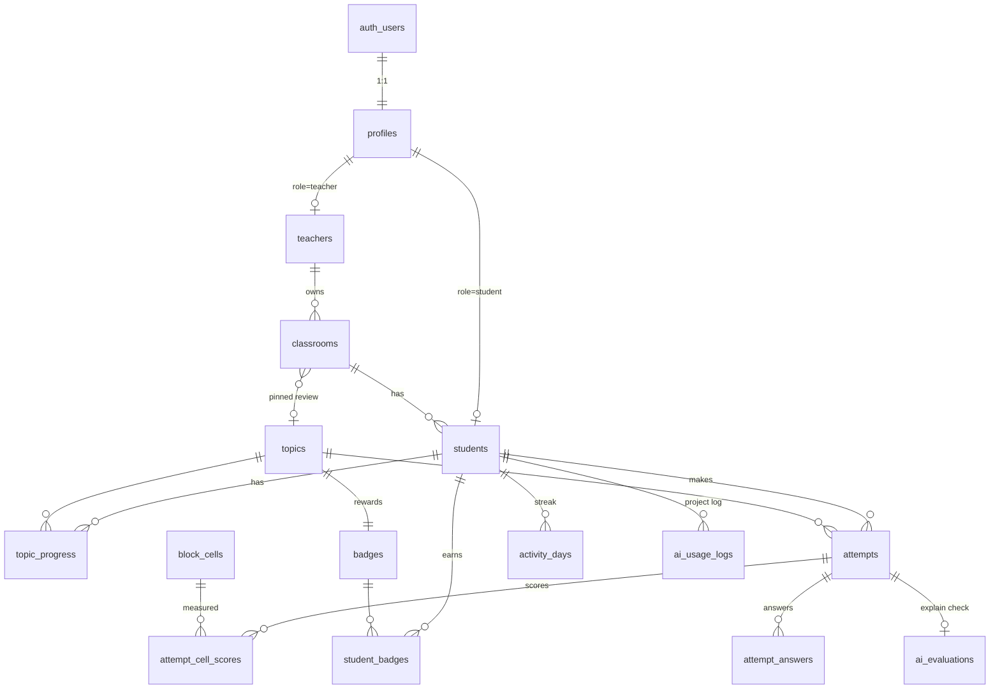

# ออกแบบฐานข้อมูล (Supabase / PostgreSQL) — "โค้ดนี้ฉันอธิบายได้"

สรุปจากโค้ดจริงในโปรเจค: `StudentRecord`, `TeacherRecord`, `ClassroomRecord` ใน `app/lib/curriculum.ts`, ฟังก์ชัน `onCompleteTopic` ใน `PracticeArena.tsx`, API `/api/auth` และ `/api/interrogate`

## 1. หลักการออกแบบ

| ประเด็น | การตัดสินใจ | เหตุผล |
|---|---|---|
| เนื้อหาด่าน/โจทย์ (`TopicQuest`, คำถาม, trace) | **เก็บในโค้ดต่อไป** ในฐานข้อมูลเก็บแค่ `topic_id` | เนื้อหาเป็น static ขนาดใหญ่ แก้ผ่าน git ได้ง่าย ไม่ต้องทำ CMS |
| Block Model 12 ช่อง (T1–F4) | ตารางอ้างอิง `block_cells` | ใช้เป็น FK และ join ทำ heatmap ฝั่งครู |
| ตัวตนผู้ใช้ | ใช้ **Supabase Auth** ทั้งครูและนักเรียน + ตาราง `profiles` แยก role | แก้ปัญหา SHA-256 และ session ใน `localStorage` ที่ไม่ปลอดภัย |
| นักเรียน (PDPA) | ไม่เก็บชื่อจริง/อีเมลจริง เก็บเฉพาะ `nickname` | ตาม PDPA 2562 |
| XP / streak / ตรา | **คำนวณจากประวัติ** (view) ไม่เก็บซ้ำ | กันข้อมูลไม่ตรงกัน และตรวจสอบย้อนหลังได้ |
| สิทธิ์เข้าถึง | **RLS** ทุกตาราง | client ใช้ anon key ได้ปลอดภัย |

### การ login ด้วยชื่อเล่น + PIN
- ครู: Supabase Auth แบบอีเมล + รหัสผ่านปกติ (หรือ username แปลงเป็นอีเมลสังเคราะห์)
- นักเรียน: API route ฝั่ง server (ใช้ service role) ค้น `students.nickname` แล้วเรียก `signInWithPassword` ด้วยอีเมลสังเคราะห์ `<user_id>@students.invalid`
- Supabase Auth ต้องการรหัสผ่านอย่างน้อย 6 ตัว จึงให้ server ต่อ `PIN + SERVER_PEPPER` ก่อนส่ง (ผู้ใช้ยังกรอก PIN 4 หลักเหมือนเดิม) และเพิ่ม rate limit/lockout ที่ route นี้

## 2. ER Diagram



## 3. ตารางหลัก

| ตาราง | หน้าที่ | ที่มาจากโค้ดเดิม |
|---|---|---|
| `profiles` | role (`student`/`teacher`) ผูกกับ `auth.users` | `role` ใน Teacher/Student |
| `teachers` | ข้อมูลครู | `TeacherRecord` |
| `classrooms` | ห้องเรียน + รหัสห้อง + หัวข้อทบทวนที่ปักหมุด | `ClassroomRecord` |
| `students` | นักเรียน (nickname, ห้อง) | `StudentRecord` |
| `topics` | อ้างอิงด่าน 1–7 (ชื่อสั้น, boss) | `TopicQuest` |
| `block_cells` | อ้างอิง 12 ช่อง Block Model | `BLOCK_MODEL_CELLS` |
| `badges` | ตราต่อด่าน | `badgeReward` |
| `attempts` | การเล่นจบหนึ่งด่าน (คะแนน, XP) แทน `history` | `onCompleteTopic` |
| `attempt_cell_scores` | คะแนนรายช่องต่อ attempt | `updatedCellScores` |
| `attempt_answers` | คำตอบรายข้อ (ใช้วิเคราะห์ข้อที่ผิดบ่อย) | `qStates` |
| `ai_evaluations` | คำอธิบายอิสระของนักเรียน + ผลตรวจจาก AI | `/api/interrogate` |
| `topic_progress` | ด่านที่ผ่านแล้ว (ปลดล็อกด่านถัดไป) | `completedTopics` |
| `student_badges` | ตราที่ได้ | `badges` |
| `activity_days` | วันที่เล่น ใช้คำนวณ streak | `streak` |
| `ai_usage_logs` | บันทึกการใช้ AI ของโครงงาน (ส่งงาน ≥ 5 prompts) | `AI_USAGE_LOGS` |

## 4. SQL Migration

```sql
create extension if not exists citext;

-- ---------- enums ----------
create type user_role as enum ('student', 'teacher');

-- ---------- identity ----------
create table profiles (
  id uuid primary key references auth.users(id) on delete cascade,
  role user_role not null,
  created_at timestamptz not null default now()
);

create table teachers (
  id uuid primary key references profiles(id) on delete cascade,
  username citext not null unique,
  display_name text not null
);

-- รหัสห้อง 6 ตัวอักษรสุ่ม (ไม่ใช้ 0/O/1/I ให้อ่านง่าย)
create or replace function gen_room_code() returns text language plpgsql as $$
declare
  chars text := 'ABCDEFGHJKLMNPQRSTUVWXYZ23456789';
  code text;
begin
  loop
    code := '';
    for i in 1..6 loop
      code := code || substr(chars, 1 + floor(random() * length(chars))::int, 1);
    end loop;
    exit when not exists (select 1 from classrooms where room_code = code);
  end loop;
  return code;
end $$;

-- ---------- reference data ----------
create table topics (
  id smallint primary key,            -- ตรงกับ TopicQuest.id ในโค้ด
  short_name text not null,
  title text not null,
  is_boss boolean not null default false
);

create table block_cells (
  id text primary key check (id ~ '^[TEF][1-4]$'),   -- T1..F4
  level smallint not null check (level between 1 and 4),
  dimension char(1) not null check (dimension in ('T','E','F')),
  related_topic_id smallint references topics(id)
);

create table badges (
  id text primary key,
  topic_id smallint not null unique references topics(id),
  name text not null,
  description text not null
);

-- ---------- classroom ----------
create table classrooms (
  id uuid primary key default gen_random_uuid(),
  room_code text not null unique default gen_room_code(),
  room_name text not null,
  teacher_id uuid not null references teachers(id) on delete cascade,
  pinned_topic_id smallint references topics(id),
  pinned_note text not null default '',
  created_at timestamptz not null default now()
);
create index on classrooms (teacher_id);

create table students (
  id uuid primary key references profiles(id) on delete cascade,
  nickname citext not null unique check (nickname !~ '@'),  -- PDPA: ห้ามอีเมล
  classroom_id uuid not null references classrooms(id) on delete restrict,
  created_at timestamptz not null default now()
);
create index on students (classroom_id);

-- ---------- learning data ----------
create table attempts (
  id uuid primary key default gen_random_uuid(),
  student_id uuid not null references students(id) on delete cascade,
  topic_id smallint not null references topics(id),
  score_percent smallint not null check (score_percent between 0 and 100),
  xp_earned integer not null check (xp_earned >= 0),
  created_at timestamptz not null default now()
);
create index on attempts (student_id, created_at desc);
create index on attempts (topic_id);

create table attempt_cell_scores (
  attempt_id uuid references attempts(id) on delete cascade,
  cell_id text references block_cells(id),
  score smallint not null check (score between 0 and 100),
  primary key (attempt_id, cell_id)
);

create table attempt_answers (
  id uuid primary key default gen_random_uuid(),
  attempt_id uuid not null references attempts(id) on delete cascade,
  question_id text not null,               -- BlockQuestion.id (อยู่ในโค้ด)
  cell_id text not null references block_cells(id),
  chosen_option_id text,
  is_correct boolean not null,
  tries smallint not null default 1,
  xp_earned smallint not null default 0
);
create index on attempt_answers (attempt_id);
create index on attempt_answers (question_id, is_correct);

create table ai_evaluations (
  attempt_id uuid primary key references attempts(id) on delete cascade,
  student_explanation text not null,
  score smallint check (score between 0 and 100),
  passed boolean not null,
  feedback text,
  created_at timestamptz not null default now()
);

create table topic_progress (
  student_id uuid references students(id) on delete cascade,
  topic_id smallint references topics(id),
  best_score_percent smallint not null default 0,
  completed_at timestamptz not null default now(),
  primary key (student_id, topic_id)
);

create table student_badges (
  student_id uuid references students(id) on delete cascade,
  badge_id text references badges(id),
  earned_at timestamptz not null default now(),
  primary key (student_id, badge_id)
);

create table activity_days (
  student_id uuid references students(id) on delete cascade,
  day date not null default current_date,
  primary key (student_id, day)
);

create table ai_usage_logs (
  id uuid primary key default gen_random_uuid(),
  student_id uuid not null references students(id) on delete cascade,
  prompt_title text not null,
  prompt_text text not null,
  problem_found text not null,
  solution_applied text not null,
  created_at timestamptz not null default now()
);

-- ---------- views (ไม่เก็บซ้ำ คำนวณเอา) ----------
-- คะแนนล่าสุดรายช่องของนักเรียนแต่ละคน
create view student_cell_latest as
select distinct on (a.student_id, c.cell_id)
       a.student_id, c.cell_id, c.score, a.created_at
from attempts a
join attempt_cell_scores c on c.attempt_id = a.id
order by a.student_id, c.cell_id, a.created_at desc;

-- XP รวม + ตราที่ได้ + จำนวนด่านที่ผ่าน
create view student_stats as
select s.id as student_id,
       s.nickname,
       s.classroom_id,
       coalesce((select sum(xp_earned) from attempts a where a.student_id = s.id), 0) as xp,
       (select count(*) from topic_progress p where p.student_id = s.id) as topics_completed,
       (select count(*) from student_badges b where b.student_id = s.id) as badges_count
from students s;

-- streak: จำนวนวันติดต่อกันจนถึงวันนี้ (หรือเมื่อวาน)
create view student_streaks as
with d as (
  select student_id, day,
         day - (row_number() over (partition by student_id order by day))::int as grp
  from activity_days
), g as (
  select student_id, grp, count(*) as len, max(day) as last_day
  from d group by student_id, grp
)
select student_id, len as streak
from g
where last_day >= current_date - 1;

-- ค่าเฉลี่ย Block Model ทั้งห้อง (ใช้ในแดชบอร์ดครู)
create view classroom_cell_avg as
select st.classroom_id, l.cell_id, round(avg(l.score), 1) as avg_score,
       count(distinct l.student_id) as students_count
from student_cell_latest l
join students st on st.id = l.student_id
group by st.classroom_id, l.cell_id;

-- ข้อที่นักเรียนตอบผิดบ่อยในห้อง
create view classroom_question_stats as
select st.classroom_id, aa.question_id, aa.cell_id,
       count(*) as answers,
       round(100.0 * avg((not aa.is_correct)::int), 1) as wrong_percent
from attempt_answers aa
join attempts a on a.id = aa.attempt_id
join students st on st.id = a.student_id
group by st.classroom_id, aa.question_id, aa.cell_id;
```

> หมายเหตุ: ให้ view ใช้ `security_invoker = true` (Postgres 15+: `alter view <ชื่อ> set (security_invoker = true);`) เพื่อให้ RLS ของตารางต้นทางยังมีผล

## 5. Row Level Security

```sql
-- helper
create or replace function is_teacher_of(room uuid) returns boolean
language sql stable security definer set search_path = public as $$
  select exists (select 1 from classrooms where id = room and teacher_id = auth.uid());
$$;

alter table profiles enable row level security;
alter table teachers enable row level security;
alter table classrooms enable row level security;
alter table students enable row level security;
alter table attempts enable row level security;
alter table attempt_cell_scores enable row level security;
alter table attempt_answers enable row level security;
alter table ai_evaluations enable row level security;
alter table topic_progress enable row level security;
alter table student_badges enable row level security;
alter table activity_days enable row level security;
alter table ai_usage_logs enable row level security;

-- ตารางอ้างอิง: อ่านได้ทุกคน เขียนไม่ได้
alter table topics enable row level security;
alter table block_cells enable row level security;
alter table badges enable row level security;
create policy ref_read on topics for select using (true);
create policy ref_read on block_cells for select using (true);
create policy ref_read on badges for select using (true);

-- profiles / teachers
create policy own_profile on profiles for select using (id = auth.uid());
create policy own_teacher on teachers for select using (id = auth.uid());

-- classrooms: ครูเจ้าของจัดการได้ นักเรียนเห็นห้องตัวเอง
create policy teacher_rooms on classrooms for all
  using (teacher_id = auth.uid()) with check (teacher_id = auth.uid());
create policy student_room on classrooms for select
  using (id in (select classroom_id from students where id = auth.uid()));

-- students: ตัวเอง + ครูเจ้าของห้อง
create policy student_self on students for select using (id = auth.uid());
create policy student_by_teacher on students for select using (is_teacher_of(classroom_id));

-- ข้อมูลการเรียนของนักเรียน: เจ้าของอ่าน/เขียน, ครูอ่านเฉพาะห้องตัวเอง
create policy own_attempts on attempts for all
  using (student_id = auth.uid()) with check (student_id = auth.uid());
create policy teacher_attempts on attempts for select
  using (is_teacher_of((select classroom_id from students where id = student_id)));

create policy own_cells on attempt_cell_scores for all
  using (attempt_id in (select id from attempts where student_id = auth.uid()))
  with check (attempt_id in (select id from attempts where student_id = auth.uid()));
create policy teacher_cells on attempt_cell_scores for select
  using (attempt_id in (select a.id from attempts a join students s on s.id = a.student_id
                        where is_teacher_of(s.classroom_id)));

create policy own_answers on attempt_answers for all
  using (attempt_id in (select id from attempts where student_id = auth.uid()))
  with check (attempt_id in (select id from attempts where student_id = auth.uid()));
create policy teacher_answers on attempt_answers for select
  using (attempt_id in (select a.id from attempts a join students s on s.id = a.student_id
                        where is_teacher_of(s.classroom_id)));

create policy own_ai_eval on ai_evaluations for select
  using (attempt_id in (select id from attempts where student_id = auth.uid()));
-- ai_evaluations เขียนผ่าน server (service role) เท่านั้น กันนักเรียนแก้คะแนน AI เอง

create policy own_progress on topic_progress for select using (student_id = auth.uid());
create policy own_badges on student_badges for select using (student_id = auth.uid());
create policy own_days on activity_days for all
  using (student_id = auth.uid()) with check (student_id = auth.uid());
create policy own_ai_logs on ai_usage_logs for all
  using (student_id = auth.uid()) with check (student_id = auth.uid());
```

> **สำคัญ:** ผลคะแนน/XP/ตรา (`attempts`, `topic_progress`, `student_badges`) ควรเขียนผ่าน API route หรือ Postgres function (`security definer`) ที่ตรวจคำตอบฝั่ง server ไม่ให้ client ส่ง XP มาเองได้ นโยบาย `own_attempts ... for all` ข้างบนเป็นแบบง่าย ถ้าต้องกันโกงให้เปลี่ยนเป็น `for select` แล้วเขียนผ่าน service role

## 6. Seed ข้อมูลอ้างอิง

```sql
insert into topics (id, short_name, title, is_boss) values
  (1,'ด่าน 1','...',false), (2,'ด่าน 2','...',false), (3,'ด่าน 3','...',false),
  (4,'ด่าน 4','...',false), (5,'ด่าน 5','...',false), (6,'ด่าน 6','...',false),
  (7,'บอส','...',true);

insert into block_cells (id, level, dimension, related_topic_id)
select d || l, l, d, null
from unnest(array['T','E','F']) d, generate_series(1,4) l;
-- แล้ว update related_topic_id ตาม BLOCK_MODEL_CELLS ใน curriculum.ts
```

ควรเขียนสคริปต์ seed ที่อ่านจาก `curriculum.ts` โดยตรง เพื่อให้ชื่อด่านและตราไม่เพี้ยนจากโค้ด

## 7. จุดที่ต้องแก้ในโค้ดเมื่อย้ายมาใช้ Supabase

| ไฟล์ | สิ่งที่ต้องทำ |
|---|---|
| `app/api/auth/route.ts` | เปลี่ยนจาก REST fetch + SHA-256 เป็น `@supabase/supabase-js` + Auth, ตรวจรหัสที่ server จริง, ใช้ cookie session (`@supabase/ssr`) |
| `app/page.tsx` | เลิกเก็บ students/teachers/classrooms/session ใน `localStorage`, โหลดจาก Supabase |
| `onCompleteTopic` | เรียก API บันทึก `attempts` + `attempt_cell_scores` + `topic_progress` + `student_badges` + `activity_days` ใน transaction เดียว (Postgres function/RPC) |
| `TeacherDashboard.tsx` | อ่านจาก `classroom_cell_avg`, `student_stats`, `classroom_question_stats` |
| `/api/interrogate` | บันทึกผลลง `ai_evaluations` |

## 8. Environment

```
NEXT_PUBLIC_SUPABASE_URL=...
NEXT_PUBLIC_SUPABASE_ANON_KEY=...      # ใช้ฝั่ง client (ปลอดภัยเมื่อเปิด RLS)
SUPABASE_SERVICE_ROLE_KEY=...          # เฉพาะ server ห้ามขึ้น client
SERVER_PEPPER=...                      # ใช้ต่อกับ PIN ก่อนส่งเข้า Supabase Auth
```

## 9. ลำดับการทำที่แนะนำ
1. สร้างโปรเจค Supabase, รัน migration (หัวข้อ 4–6)
2. ทำ auth (ครู → นักเรียน) พร้อม cookie session และ rate limit
3. ย้ายห้องเรียนและนักเรียนจาก `localStorage`
4. ทำ RPC บันทึกผลด่าน แล้วต่อแดชบอร์ดครูเข้ากับ view
5. ลบ `INITIAL_*` mock data และ fallback `source: "local"` ออก
