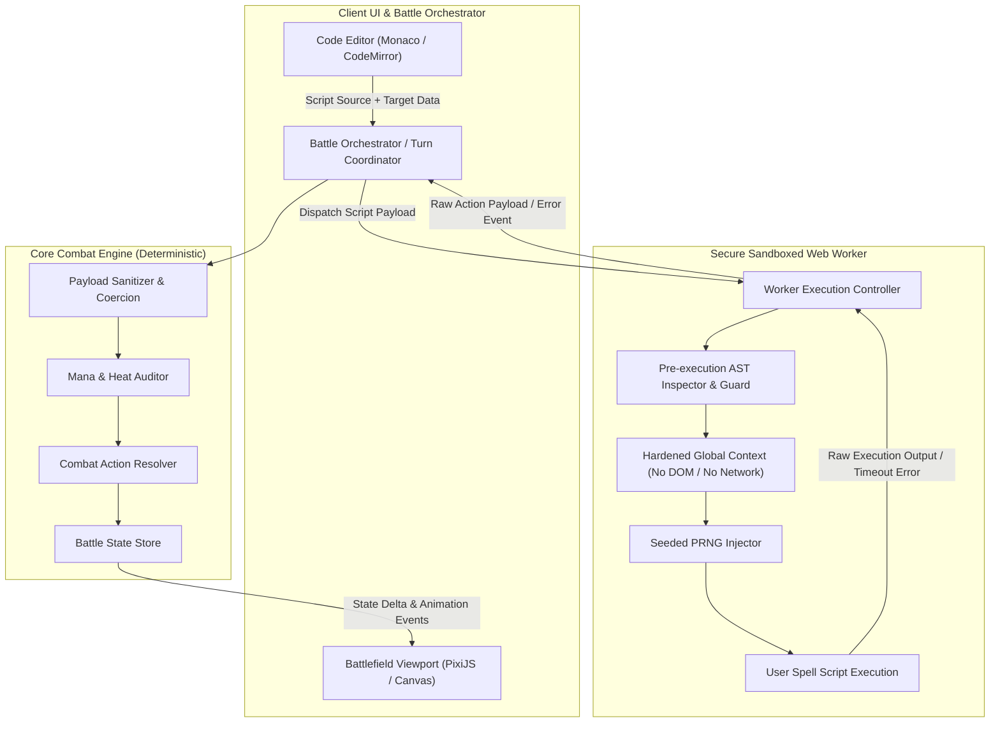
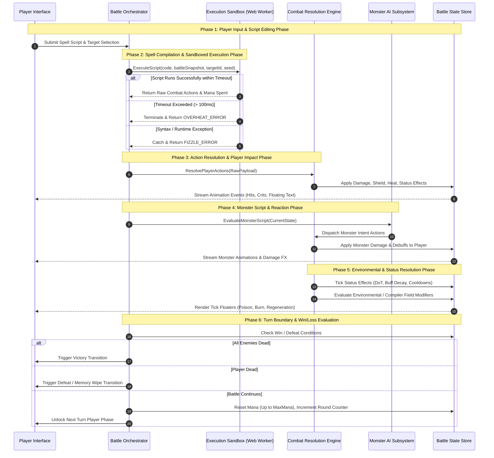
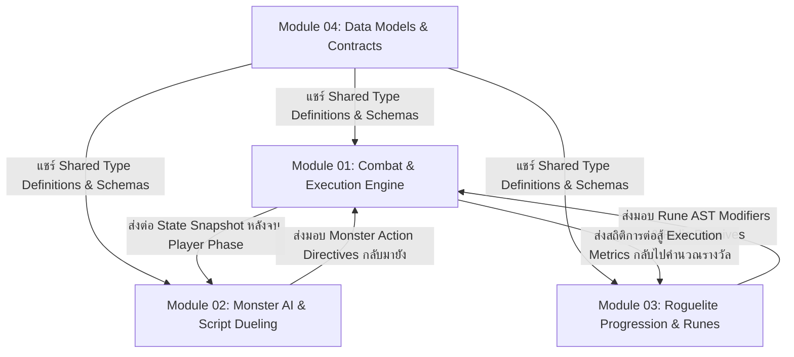

# สถาปัตยกรรมระบบต่อสู้และเครื่องยนต์รันโค้ด (Combat & Execution Engine Architecture)
**เอกสารลำดับที่:** 01  
**รหัสโมดูล:** `MODULE_01_COMBAT_AND_EXECUTION_ENGINE`  
**สถานะ:** Production Blueprint  
**ระบบเป้าหมาย:** CODE DEPTHS (Tactical Code-Battler)  

---

## 1. บทนำและวิสัยทัศน์ทางเทคนิค (Technical Overview & Scope)

ระบบต่อสู้ของ CODE DEPTHS ไม่ใช่เกมตอบคำถามหรือแพลตฟอร์มตรวจแบบฝึกหัดเขียนโค้ด (Coding Quiz) ทั่วไป แต่เป็นระบบ **Tactical Script-driven Battle Engine** โดยโค้ดภาษา JavaScript/TypeScript ที่ผู้เล่นเขียนขึ้นจะทำหน้าที่เป็น "สคริปต์แกนเวทมนตร์" (Ability Core Script) ที่รับสภาวะสนามรบเข้าไปคำนวณและส่งมอบคำสั่งยุทธวิธี (Action Directives) ออกมาประมวลผลในสนามรบจริง

### 1.1 วัตถุประสงค์หลักของระบบ (Core System Objectives)
1. **Deterministic & Isolated Execution:** การรันโค้ดของผู้เล่นต้องเกิดขึ้นในสภาพแวดล้อมที่ปลอดภัย (Isolated Sandbox) แยกออกจาก Main UI Thread ไม่สามารถเจาะระบบหรือรบกวน DOM ได้ และให้ผลลัพธ์สม่ำเสมอภายใต้ Seed สุ่มเดียวกัน
2. **Translating Logic into Mechanics:** โครงสร้างควบคุมทางคอมพิวเตอร์ (Loops, Conditionals, Accumulators, Functions) ต้องถูกแปลงเป็นกลไกทางเกมเพลย์ที่มีมิติเชิงยุทธวิธี (Multi-hit, Proc Chance, Burst Scaling) ที่มีความคุ้มค่าและต้นทุนทรัพยากร (Risk vs Reward)
3. **Graceful Error Degradation:** ไม่มีสถานะ Game Crash หรือการค้างจาก Infinite Loop ข้อผิดพลาดทางไวยากรณ์ (Syntax Error) หรือตรรกะที่พัง (Runtime/Type Error) จะต้องถูกแปลงเป็นสถานะการต่อสู้ในเกม เช่น Spell Fizzle (ร่ายล้มเหลว) หรือ Overheat (ระบบระบายความร้อนล้มเหลว) ตามข้อตกลงของ Master Design Charter

### 1.2 แผนภาพสถาปัตยกรรมระบบระดับสูง (High-Level System Architecture)



---

## 2. วงจรการต่อสู้แบบเทิร์นเบส (Turn-based Combat Loop Lifecycle)

การต่อสู้ในแต่ละรอบ (Combat Round) ประกอบด้วย 6 เฟสหลักที่ดำเนินไปตามลำดับเวลาที่แน่นอน (Strict Sequential Lifecycle) โดยไม่มีการข้ามขั้นตอน เพื่อให้การคำนวณสถานะและการแสดงผลมีความแน่นอนและโปร่งใส



### 2.1 รายละเอียดของแต่ละเฟส (Phase Breakdown)

#### Phase 1: Player Input & Script Editing Phase
- ผู้เล่นเปิดหน้าต่าง Code Editor เพื่อเขียน, ปรับแต่ง, หรือเลือกรวมรูน (Rune Injection) ในฟังก์ชันเวทมนตร์
- ผู้เล่นเลือกเป้าหมายหลัก (Primary Target Enemy)
- ระบบทำการตรวจสอบความพร้อมของทรัพยากรเบื้องต้น (เช่น มี Mana ขั้นต่ำเพียงพอสำหรับการรันสคริปต์หรือไม่)
- เมื่อผู้เล่นกดยืนยันการร่าย (Cast Spell) อินพุตจะถูกล็อกทันทีเพื่อป้องกันการเปลี่ยนแปลงระหว่างการคำนวณ

#### Phase 2: Spell Compilation & Sandboxed Execution Phase
- Battle Orchestrator ทำการโคลนสภาพแวดล้อมสนามรบ (Deep Clone Snapshot) เพื่อส่งไปยัง Web Worker ป้องกันไม่ให้สคริปต์ผู้เล่นสามารถกลายพันธุ์ (Mutate) สถานะจริงโดยตรง
- Web Worker รับ Snapshot, Target Entity, Player Stats, และค่า Seed สุ่ม
- ทำการรันสคริปต์โดยจำกัดเวลา (Time-budgeted Execution: เพดาน 100 มิลลิวินาที)
- สคริปต์จะคืนค่าออบเจกต์คำสั่งการต่อสู้ (Combat Action Directives) หรือส่งสัญญาณข้อผิดพลาดกลับมา

#### Phase 3: Action Resolution & Player Impact Phase
- Engine ทำการตรวจสอบความถูกต้องของ Action (Sanitization) ป้องกันการส่งค่าโกง เช่น ดาเมจมหาศาลเกินขอบเขตที่สถิติตัวละครอนุญาต หรือการคืนค่าตัวเลขติดลบ
- ตรวจสอบยอดรวมของ Mana Cost ที่เกิดขึ้นจากตรรกะโค้ด หาก Mana ไม่พอ คำสั่งที่เกินจะถูกตัดทิ้งตามลำดับ (FIFO Action Drop)
- ประมวลผลผลลัพธ์ลงสู่เป้าหมาย:
  - คำนวณความต้านทานธาตุ (Elemental Resistances)
  - หักล้างด้วยค่าเกราะป้องกัน (Shield Absorption)
  - ลดทอนพลังชีวิต (HP Depletion)
  - ผูกติดสถานะผิดปกติ (Status Infliction)
- ส่ง Event Stream ไปยัง Viewport เพื่อเรนเดอร์แอนิเมชันตามลำดับการโจมตี

#### Phase 4: Monster Script & Reaction Phase
- มอนสเตอร์แต่ละตัวในสนามรบประมวลผลตรรกะสคริปต์ AI ประจำตัว (Monster Script) ตามพารามิเตอร์ของตัวเอง (ดูรายละเอียดสถาปัตยกรรมมอนสเตอร์ใน Module 02)
- หากมอนสเตอร์ติดสถานะ Stun, Frozen หรือ Overheated ใน Phase 3 สิทธิ์การเดินจะถูกข้าม
- คำสั่งโจมตีและบัฟของมอนสเตอร์จะถูกส่งเข้า Combat Resolution Engine และประมวลผลใส่ผู้เล่น

#### Phase 5: Environmental & Status Resolution Phase (Tick Phase)
- ทำการประมวลผลสถานะต่อเนื่อง (Status Tick):
  - ดาเมจไฟไหม้ (Burn), สารพิษ (Poison), ไฟฟ้าลัดวงจร (Shock)
  - การฟื้นฟูพลังชีวิตและเกราะ (Regeneration / Shield Decay)
- ลดระยะเวลาของบัฟและดีบัฟ (Duration Counter Decrement)
- ตรวจสอบสถานะสิ่งแวดล้อม (Compiler Modifiers เช่น Global Variable Surge หรือ Garbage Collector Wave)

#### Phase 6: Turn Boundary & Win/Loss Evaluation
- ประเมินสถานะการรอดชีวิตของทุกเอนทิตี:
  - หาก HP ศัตรูทั้งหมด <= 0: ประกาศชัยชนะ (Battle Won)
  - หาก HP ผู้เล่น <= 0: ประกาศพ่ายแพ้ (Execution Aborted / Defeat)
- หากการต่อสู้ยังดำเนินอยู่:
  - เคลียร์ค่า Overheat ชั่วคราว (หากครบกำหนด)
  - ฟื้นฟูค่า Mana ของผู้เล่นตามค่า Base Mana Recovery Rate
  - ปรับปรุงหมายเลขเทิร์น (Turn Number += 1)
  - คืนสิทธิ์การควบคุมให้แก่ผู้เล่นในเฟส 1

---

## 3. สัญญาการรันสคริปต์เวทมนตร์ (Spell Execution Contract)

ฟังก์ชันเวทมนตร์ที่ผู้เล่นเขียนต้องปฏิบัติตามมาตรฐานอินเทอร์เฟซของระบบ โดยเป็นฟังก์ชันที่รับสภาวะสนามรบและคืนค่าชุดคำสั่งการต่อสู้

### 3.1 ฟังก์ชันซิกเนเจอร์ (Function Signature)

```typescript
type SpellFunction = (
  battleState: Readonly<BattleStateSnapshot>,
  targetEnemy: Readonly<EnemySnapshot>,
  playerStats: Readonly<PlayerStatsSnapshot>
) => SpellExecutionOutput;
```

### 3.2 รายละเอียดพารามิเตอร์ขาเข้า (Input Parameters)

#### 1. `battleState: Readonly<BattleStateSnapshot>`
ภาพสะท้อนสภาวะแวดล้อมสนามรบ ณ ขณะร่าย (Immutable):
```typescript
interface BattleStateSnapshot {
  round: number;                          // รอบการต่อสู้ปัจจุบัน (เริ่มต้นที่ 1)
  turnCount: number;                      // จำนวนเทิร์นสะสม
  enemies: ReadonlyArray<EnemySnapshot>;  // รายชื่อศัตรูทั้งหมดที่มีชีวิตอยู่ในสนามรบ
  activeCompilerRule: string | null;     // กฎพิเศษประจำสมรภูมิ (เช่น "STRICT_TYPING", "STACK_OVERFLOW_RISK")
  environmentalElement: ElementType;     // สภาพอากาศธาตุประจำห้อง (None, Fire, Ice, Lightning, Void)
  graveyardCount: number;                 // จำนวนศัตรูที่ถูกกำจัดไปแล้วในการต่อสู้นี้
}
```

#### 2. `targetEnemy: Readonly<EnemySnapshot>`
ข้อมูลของศัตรูที่ผู้เล่นเลือกเป็นเป้าหมายหลัก:
```typescript
interface EnemySnapshot {
  id: string;                             // รหัสเฉพาะของศัตรู
  name: string;                           // ชื่อมอนสเตอร์
  hp: number;                             // พลังชีวิตปัจจุบัน
  maxHp: number;                          // พลังชีวิตสูงสุด
  shield: number;                         // เกราะป้องกันปัจจุบัน
  element: ElementType;                   // ธาตุประจำตัวของศัตรู
  intent: EnemyIntentPreview;             // พฤติกรรมที่ศัตรูกำลังจะทำในเทิร์นนี้ (Attack, Defend, Debuff)
  statusEffects: ReadonlyArray<ActiveStatusEffect>; // บัฟและดีบัฟที่ติดอยู่บนตัวศัตรู
  traits: ReadonlyArray<string>;          // คุณสมบัติพิเศษ เช่น "ARMOURED", "REFLECTIVE", "RECURSIVE"
}
```

#### 3. `playerStats: Readonly<PlayerStatsSnapshot>`
ค่าสถิติและพลังของผู้เล่นในเทิร์นปัจจุบัน:
```typescript
interface PlayerStatsSnapshot {
  hp: number;                             // พลังชีวิตปัจจุบัน
  maxHp: number;                          // พลังชีวิตสูงสุด
  mp: number;                             // มานาที่พร้อมใช้งานในเทิร์นนี้
  maxMp: number;                          // ขีดจำกัดมานาสูงสุด
  baseSpellPower: number;                 // พลังโจมตีเวทมนตร์พื้นฐาน
  critChance: number;                     // โอกาสติดคริติคอลพื้นฐาน (0.00 - 1.00)
  critMultiplier: number;                 // อัตราคูณความเสียหายคริติคอล (เช่น 1.5, 2.0)
  elementalAffinities: Record<ElementType, number>; // ค่าโบนัสความชำนาญธาตุ (Multiplier)
  equippedRunes: ReadonlyArray<string>;   // รูนตรรกะพิเศษที่สวมใส่อยู่
}
```

### 3.3 รายละเอียดผลลัพธ์ขาออก (Return Output Schema)

ผลลัพธ์ที่ฟังก์ชันของผู้เล่นส่งคืนกลับมาต้องมีโครงสร้างตามสัญญาข้อมูลดังต่อไปนี้:

```typescript
interface SpellExecutionOutput {
  actions: CombatActionPayload[];         // รายการคำสั่งยุทธวิธีที่ต้องการปล่อยลงสนาม
  meta?: {
    customLog?: string;                   // ข้อความสำหรับแสดงใน Combat Console ของผู้เล่น
    spellName?: string;                   // ชื่อท่าที่ผู้เล่นตั้งเอง
  };
}

interface CombatActionPayload {
  type: CombatActionType;                 // ชนิดของคำสั่ง (DAMAGE, HEAL, SHIELD, APPLY_STATUS)
  targetId: string;                       // รหัสเป้าหมายที่ต้องการส่งผล (เช่น targetEnemy.id หรือ "player")
  element: ElementType;                   // ธาตุของการกระทำ
  baseMagnitude: number;                  // ปริมาณพื้นฐานของดาเมจ / การฮีล / เกราะ
  costBreakdown?: {
    mana: number;                         // มานาที่สคริปต์ยินดีจ่ายสำหรับการกระทำนี้
  };
  statusToApply?: {
    name: StatusEffectType;               // ชนิดของสถานะ (BURN, FREEZE, SHOCK, CORROSION, LIFESTEAL)
    duration: number;                     // จำนวนเทิร์น
    potency: number;                      // ความรุนแรงของสถานะ
  };
}
```

### 3.4 ประเภทข้อมูลพื้นฐาน (Enums & Supporting Types)

```typescript
type ElementType = "Physical" | "Fire" | "Ice" | "Lightning" | "Corrosion" | "Void";

type CombatActionType = 
  | "DIRECT_DAMAGE" 
  | "PIERCING_DAMAGE" 
  | "RESTORE_HP" 
  | "GRANT_SHIELD" 
  | "APPLY_STATUS" 
  | "PURGE_DEBUFF";

type StatusEffectType = 
  | "BURN"          // ดาเมจไฟต่อเนื่อง
  | "FREEZE"        // ลดความเร็วเทิร์น / ลบล้างการเดิน
  | "SHOCK"         // กระจายดาเมจเมื่อได้รับความเสียหาย
  | "CORROSION"     // กัดกร่อนเกราะทุกเทิร์น
  | "LIFESTEAL"     // เปลี่ยนดาเมจที่ทำได้เป็นเลือด
  | "OVERHEATED";   // ติดสตันจากการใช้ลูปเกินขนาด
```

---

## 4. การแปลงโครงสร้างโค้ดเป็นกลไกการต่อสู้ (Translating Code Structure to Combat Mechanics)

หัวใจสำคัญของ CODE DEPTHS คือการทำให้ผู้เล่นรู้สึกว่า "โครงสร้างของโค้ดคือสถาปัตยกรรมของเวทมนตร์" ไม่ใช่การพิมพ์โค้ดเพื่อแก้โจทย์ ทุกคำสั่งและโครงสร้างทางตรรกะจะส่งผลสะท้อนต่อกลไกการรบจริงในสนาม

### 4.1 Loops (for, while, forEach) -> Multi-hit Combo & AoE

การวนลูปคือการร่ายเวทมนตร์ซ้ำอย่างต่อเนื่องเพื่อสร้างคอมโบหลายจังหวะ (Multi-hit Attacks) หรือการกระจายผลลัพธ์ใส่ศัตรูทั้งสนามรบ (Area of Effect)

#### 1. กฎการคำนวณมานาของลูป (Loop Mana Cost Formula)
การรันโค้ดซ้ำๆ มีต้นทุนทางพลังงานที่เพิ่มขึ้นแบบขั้นบันไดก้าวหน้า (Progressive Scaling) เพื่อป้องกันไม่ให้ผู้เล่นเขียนลูป 1,000 รอบเพื่อสังหารศัตรูในทันที

สูตรการคำนวณมานาสำหรับรอบการรันที่ $i$ (โดยที่ $i$ เริ่มจาก 0):
$$\text{IterationManaCost}(i) = \text{BaseSpellCost} \times \left(1 + i \times \text{LoopCostMultiplier}\right)$$

ยอดรวมมานาที่ต้องจ่ายทั้งหมดสำหรับลูป $N$ รอบ:
$$\text{TotalManaRequired}(N) = \sum_{i=0}^{N-1} \text{IterationManaCost}(i) = N \times \text{BaseSpellCost} + \text{BaseSpellCost} \times \text{LoopCostMultiplier} \times \frac{(N-1)N}{2}$$

**ค่าคงที่มาตรฐานของระบบ:**
- `BaseSpellCost` = 5 Mana
- `LoopCostMultiplier` = 0.40 (ค่าใช้จ่ายเพิ่มขึ้น 40% ทุกรอบที่วนเพิ่ม)
- ขีดจำกัดลูปปลอดภัย (Safe Iteration Limit): สูงสุดไม่เกิน 8 รอบต่อหนึ่งสเปลล์

**ตารางเปรียบเทียบต้นทุนลูป (สมมติ Base = 5 Mana):**
| รอบที่ ($i$) | มานาประจำรอบ | มานาสะสมรวม | การเกิดผลในสนามรบ |
|---|---|---|---|
| 1 ($i=0$) | 5.0 MP | 5.0 MP | ฮิตที่ 1: ดาเมจ 100% |
| 2 ($i=1$) | 7.0 MP | 12.0 MP | ฮิตที่ 2: ดาเมจ 85% (Diminishing return) |
| 3 ($i=2$) | 9.0 MP | 21.0 MP | ฮิตที่ 3: ดาเมจ 75% |
| 4 ($i=3$) | 11.0 MP | 32.0 MP | ฮิตที่ 4: ดาเมจ 65% |
| 5 ($i=4$) | 13.0 MP | 45.0 MP | ฮิตที่ 5: ดาเมจ 55% |
| > 8 รอบ | ฉุกเฉิน | เกินขีดจำกัด | เข้าสู่สภาวะเสี่ยง Overheat ทันที |

#### 2. กลไก AoE Targeting ผ่านการวนลูปอาเรย์ศัตรู
หากผู้เล่นใช้โครงสร้าง:
```javascript
for (const enemy of battleState.enemies) {
  // สร้าง Action โจมตี enemy แต่ละตัว
}
```
ระบบจะระบุเป็น **Smart AoE Targeting** โดยคิดต้นทุนมานาแบบกระจายเป้าหมาย (Split Mana Cost) แทนที่จะคิดแบบลูปเดี่ยวทับทวี ทำให้การวนลูปตามจำนวนศัตรูจริงในสนามมีความคุ้มค่าเชิงยุทธวิธีมากกว่าการวนลูปตัวเลขคงที่

---

### 4.2 Conditionals (if / else if / else) -> Proc Chance & Tactical Triggers

คำสั่งเงื่อนไขทำหน้าที่เป็น "ระบบไหวพริบและยุทธวิธีตอบสนอง" (Tactical Response Logic) ช่วยให้เวทมนตร์ปรับเปลี่ยนรูปแบบตามสถานการณ์จริงในสนามรบ

#### 1. การจำลองโอกาสติดผลพิเศษ (Proc Chance Simulation)
ผู้เล่นสามารถใช้ฟังก์ชันสุ่มเชิงความน่าจะเป็นเพื่อลุ้นผลลัพธ์รุนแรง (Critical Strike / Status Explosion) ผ่านการสร้างเงื่อนไข:
```javascript
const procRoll = Math.random(); // ระบบจะ Inject Seeded Deterministic PRNG
if (procRoll < playerStats.critChance + 0.15) {
  // บาเรลระเบิดคริติคอล 200% ดาเมจ
} else {
  // โจมตีแบบปกติ เสียมานาน้อย
}
```

#### 2. ระบบตอบสนองยุทธวิธี (Tactical Triggers)
การสร้างตรรกะเพื่อแก้ทางพฤติกรรมและสถานะของศัตรู:
- **Shield Breaker Logic:**
  ```javascript
  if (targetEnemy.shield > 0) {
    // เปลี่ยนประเภทดาเมจเป็น PIERCING_DAMAGE ทะลุเกราะ
    // หรือเลือกใช้ธาตุ Corrosion เพื่อกัดกร่อนเกราะทิ้ง
  }
  ```
- **Intent Counter Trigger:**
  ```javascript
  if (targetEnemy.intent.actionType === "HEAVY_ATTACK") {
    // ผู้เล่นเปลี่ยนท่าเป็นการกางเกราะป้องกัน (GRANT_SHIELD) แทนการโจมตี
  }
  ```

#### 3. กลไกตาข่ายนิรภัย (Safety Nets & Emergency Logic)
ผู้เล่นสามารถเขียนเงื่อนไขประเมินเลือดตนเองเพื่อสลับโหมดเอาตัวรอดอัตโนมัติ:
```javascript
if (playerStats.hp < playerStats.maxHp * 0.30) {
  // เลือดต่ำกว่า 30%: สลับโหมดเป็น Lifesteal Vampiric Blade ดูดเลือดกลับทันที
} else {
  // เลือดเต็ม: เน้น Full Power Fireball
}
```
**ผลลัพธ์ในเกม:** สคริปต์นี้ทำให้ผู้เล่นมี "บอทยุทธวิธีส่วนตัว" ที่คอยพิทักษ์ชีพโดยไม่ต้องเสียสมาธิเลือกการกระทำด้วยมือทุกเทิร์น

---

### 4.3 Accumulators & Array Reductions -> Burst Scaling & Charge Mechanics

การสะสมค่าตัวเลขผ่านตัวแปรสะสม (`total += x`) หรือการใช้ Higher-order Functions (`reduce`, `filter`) คือหัวใจของการสร้างความเสียหายแบบระเบิดพลังมหาศาล (Burst Damage / Charge-up)

#### 1. กลไกสะสมพลังงาน (Energy Charge Accumulation)
เมื่อผู้เล่นสะสมตัวเลขในลูปหรือตามเงื่อนไข:
```javascript
let chargeAccumulator = 0;
for (let i = 0; i < 4; i++) {
  chargeAccumulator += (playerStats.baseSpellPower * 0.4);
}
// ปล่อยคลื่นพลังงานนัดเดียวด้วยขนาด chargeAccumulator
```

**สูตรการขยายผลแบบไม่เป็นเชิงเส้น (Non-linear Burst Scaling):**
เพื่อสร้างความคุ้มค่าให้กับการเก็บสะสมพลังงาน ระบบจะมอบโบนัสตัวคูณ **Resonance Bonus** เมื่อตัวแปรสะสมมีจำนวนรอบการบวกเพิ่มขึ้น:
$$\text{BurstMagnitude} = \text{AccumulatedValue} \times \left(1 + (\text{ChargeSteps} \times 0.12)\right)$$

หากชาร์จ 4 ขั้น: ได้โบนัสพลังงานทวีคูณเพิ่มขึ้นอีก 48% เมื่อเทียบกับการยิงแยก 4 นัดเดี่ยวๆ แต่ต้องแลกกับความเสี่ยง: หากถูกขัดขวางหรือคำนวณมานาพลาด การโจมตีทั้งหมดจะสูญเปล่าทันที

#### 2. การกรองและคัดสรรเป้าหมาย (Tactical Filtering)
การใช้ Array Methods เช่น `filter` และ `sort` เพื่อเล็งเป้าหมายที่เปราะบางที่สุด:
```javascript
const weakestEnemy = battleState.enemies
  .slice()
  .sort((a, b) => a.hp - b.hp)[0];

// กำหนดเป้าหมายการโจมตีไปที่ศัตรูที่ใกล้ตายที่สุดเพื่อตัดกำลังรบ
```

---

## 5. สถาปัตยกรรมแซนด์บ็อกซ์และการจัดการข้อผิดพลาด (Sandbox Architecture & Graceful Error Handling)

ระบบของ CODE DEPTHS ต้องรับโค้ดที่ผู้ใช้งานพิมพ์สดได้อย่างไม่จำกัด ดังนั้นความมั่นคงปลอดภัย (Security), เสถียรภาพของเบราว์เซอร์ (Stability), และความเป็นธรรมของการจำลอง (Determinism) จึงเป็นเรื่องที่ยอมประนีประนอมไม่ได้

### 5.1 การแยกเธรดและการควบคุมสภาพแวดล้อม (Web Worker Isolation)

สคริปต์ของผู้เล่นจะถูกส่งไปประมวลผลบน **Dedicated Web Worker** ที่ถูกตัดสิทธิ์การเข้าถึง API อันตรายทั้งหมดของระบบเบราว์เซอร์

```mermaid
flowchart LR
    subgraph HostMainThread ["Host Browser Main Thread"]
        UI_Thread["Game Loop & UI Render"]
        WorkerManager["Web Worker Manager"]
        TimeoutTimer["Abort Controller (100ms Watchdog)"]
    end

    subgraph SandboxedWorker ["Isolated Web Worker"]
        ScopeLockdown["Global Scope Lockdown (Nullify Window/Fetch/Eval)"]
        PRNG_Engine["Deterministic Seeded PRNG Engine"]
        ScriptWrapper["Sandboxed Function Evaluator"]
    end

    WorkerManager -->|postMessage: Code, StateSnapshot, Seed| SandboxedWorker
    TimeoutTimer -.->|Force worker.terminate() if > 100ms| SandboxedWorker
    SandboxedWorker --> ScopeLockdown
    ScopeLockdown --> PRNG_Engine
    PRNG_Engine --> ScriptWrapper
    ScriptWrapper -->|postMessage: ExecutionResult| WorkerManager
```

#### 1. การล็อกดาวน์สภาพแวดล้อมสโคป (Global Lockdown Implementation)
ก่อนรันโค้ดของผู้เล่น Web Worker จะรันสคริปต์ Sanitizer เพื่อปิดกั้นการเข้าถึงออบเจกต์ระบบทั้งหมด:
- `self.window = undefined;`
- `self.document = undefined;`
- `self.fetch = undefined;`
- `self.XMLHttpRequest = undefined;`
- `self.WebSocket = undefined;`
- `self.localStorage = undefined;`
- `self.sessionStorage = undefined;`
- `self.indexedDB = undefined;`
- `self.eval = undefined;`
- `self.Function = undefined;` (ปิดกั้น Dynamic Code Generation ภายใน)
- ปิดกั้นการเจาะผ่าน Prototype Chaining ด้วย `Object.freeze(Object.prototype)`

#### 2. การควบคุมความสุ่มแบบ Deterministic (Seeded PRNG)
ระบบจะไม่ยอมให้ใช้ `Math.random()` ของเครื่องโดยตรง แต่จะแทรก (Inject) ฟังก์ชันสุ่มแบบ PRNG (เช่น xoshiro128** หรือ mulberry32) ที่ผูกกับ Battle Seed ประจำเทิร์น เพื่อให้การรันโค้ดซ้ำในการ Replay หรือ Network Synchronization ให้ผลลัพธ์ตรงกัน 100% เสมอ

```javascript
// ตัวอย่างการจำลอง Seeded Random Generator ภายใน Sandbox
function createSeededPRNG(seed) {
  let s = seed >>> 0;
  return function() {
    s = (s + 0x6D2B79F5) | 0;
    let t = Math.imul(s ^ (s >>> 15), 1 | s);
    t = (t + Math.imul(t ^ (t >>> 7), 61 | t)) ^ t;
    return ((t ^ (t >>> 14)) >>> 0) / 4294967296;
  };
}
```

---

### 5.2 กลไกการเปลี่ยนข้อผิดพลาดเป็นผลลัพธ์ในเกม (Graceful Degradation Rules)

ตามกฎข้อที่ 1 ของ Master Design Charter: **ห้ามมีสถานะ Instant Game Over หรือแอปพลิเคชันค้างเมื่อโค้ดมีบั๊ก** ทุกข้อผิดพลาดจะถูกแปลงเป็นสถานะการต่อสู้ (In-game Combat Penalties) ที่สมเหตุสมผล

| ประเภทข้อผิดพลาด (Error Type) | สาเหตุทางเทคนิค (Technical Cause) | กลไกในเกม (In-Game Mechanic) | ผลกระทบในสนามรบ (Battlefield Consequence) |
|---|---|---|---|
| **Infinite Loop / Timeout** | ลูป `while(true)` หรือเงื่อนไขลูปไม่บรรจบเกิน 100ms | **SYSTEM OVERHEAT (ความร้อนเกินพิกัด)** | ผู้เล่นติดสถานะ **Stun** 1 เทิร์น, สเปลล์ถูกยกเลิก, ได้รับดาเมจย้อนกลับ 10% ของ MaxHP จากไอความร้อน |
| **Syntax Error** | ลืมปิดวงเล็บ, สะกดคำสงวนผิด, ไวยากรณ์ไม่ถูกต้อง | **SPELL FIZZLE (เวทมนตร์ล้มเหลว)** | เกิดควันฟู่สีเทา ดาเมจ 0, เสีย Base Mana ขั้นต่ำ 5 MP, ไม่ติดสตัน สามารถแก้ตัวในเทิร์นถัดไปได้ |
| **Reference / Type Error** | เรียกตัวแปรที่ไม่มีอยู่จริง (`undefined.hp`), ฟังก์ชันผิด | **GLITCH BACKFIRE (กระแสเวทสะท้อน)** | สเปลล์หยุดทำงานกะทันหัน ส่งผลให้ดาเมจเหลือเพียง 1 ดาเมจกายภาพ และเสียมานาตามที่คำนวณไว้ |
| **NaN / Infinite Output** | หารด้วยศูนย์ (`x / 0`), คำนวณหลุดขอบเขตตัวเลข | **DATA CORRUPTION (ข้อมูลบิดเบือน)** | ตัวเลขจะถูก Coerce เป็น 0 ดาเมจทันที พร้อมสร้างเสียง Sound FX สัญญาณรบกวน |
| **Mana Starvation** | โค้ดสร้าง Actions รวมเกินกว่ามานาปัจจุบันที่ตัวละครมี | **ENERGY INSUFFICIENCY (มานาไม่พอ)** | ระบบจะรันคำสั่งตามลำดับ (FIFO) จนกระทั่งมานาหมด และตัดคำสั่งที่เหลือทิ้งอัตโนมัติ |

#### 1. รายละเอียดการทำงานของ Overheat Watchdog
เมื่อ Web Worker เริ่มรันโค้ดของผู้เล่น:
1. Main Thread จะตั้งนาฬิกาจับเวลา `watchdogTimeout = setTimeout(..., 100)` (100ms)
2. หากสคริปต์ยังไม่ส่งผลลัพธ์กลับมาภายใน 100ms:
   - Main Thread จะสั่ง `worker.terminate()` ทันทีเพื่อหยุดการเผาผลาญ CPU
   - Main Thread จะสร้าง Web Worker ตัวใหม่ขึ้นมาทดแทนสำหรับเทิร์นถัดไปทันที
   - ส่งผลลัพธ์ `OVERHEAT_PENALTY` ไปยัง Combat Resolution Engine:
     - ติดสถานะ `OVERHEATED` ให้ผู้เล่น 1 เทิร์น (ข้ามเทิร์นถัดไป)
     - สร้าง Floating Text แจ้งเตือน: `"COMPILER OVERHEAT: INFINITE LOOP INTERRUPTED!"`
     - นำค่าความเสียหายย้อนกลับใส่พลังชีวิตผู้เล่น

#### 2. กลไกการขัดเกลาข้อมูล (Payload Sanitizer & Coercion)
เมื่อ Worker ส่งข้อมูล Actions กลับมา Combat Engine จะทำการกรองความถูกต้องก่อนนำไปคิดคำนวณจริง:
```typescript
function sanitizeAction(rawAction: any, player: PlayerStatsSnapshot): CombatActionPayload {
  // บังคับแปลงค่า magnitude เป็นตัวเลขจำกัด
  let magnitude = Number(rawAction.baseMagnitude);
  if (isNaN(magnitude) || !isFinite(magnitude) || magnitude < 0) {
    magnitude = 0; // Coerce NaN หรือค่าลบให้เป็น 0 ป้องกันโกงหรือบั๊ก
  }

  // ป้องกันค่าดาเมจสูงเกินจริง (Cap at Max Possible Scaling)
  const maximumPermittedDamage = player.baseSpellPower * 20;
  if (magnitude > maximumPermittedDamage) {
    magnitude = maximumPermittedDamage;
  }

  return {
    type: rawAction.type || "DIRECT_DAMAGE",
    targetId: String(rawAction.targetId),
    element: rawAction.element || "Physical",
    baseMagnitude: magnitude,
    costBreakdown: {
      mana: Math.max(0, Number(rawAction.costBreakdown?.mana) || 0)
    },
    statusToApply: rawAction.statusToApply
  };
}
```

---

## 6. ตัวอย่างการทำงานจริงของคาถา (Production-Ready Code Snippets & Execution Walkthroughs)

เพื่อให้เห็นภาพการนำทฤษฎีไปใช้งานจริงอย่างแจ่มชัด หัวข้อนี้แสดงตัวอย่างโค้ดเวทมนตร์ 3 รูปแบบ พร้อมการแปลงเป็น Action Payloads และผลกระทบต่อสภาวะสนามรบจริง

---

### กรณีศึกษาที่ 1: Fireball Barrage (Multi-hit Loop & Burn Infliction)

สเปลล์ไฟหลายจังหวะที่วนลูปโจมตี 3 ฮิต พร้อมคิดคำนวณมานาทับทวีและแปะสถานะ Burn ในฮิตสุดท้าย

#### โค้ด JavaScript ของผู้เล่น:
```javascript
function castSpell(battleState, targetEnemy, playerStats) {
  const actions = [];
  const hitCount = 3;
  const baseCostPerHit = 6;
  const loopMultiplier = 0.35;

  for (let i = 0; i < hitCount; i++) {
    // คำนวณมานาตามสูตร Loop Scaling
    const hitManaCost = baseCostPerHit * (1 + (i * loopMultiplier));
    
    // ดาเมจลดหลั่นลงเล็กน้อยตามจำนวนฮิต (100%, 85%, 70%)
    const damageDecay = 1 - (i * 0.15);
    const hitDamage = playerStats.baseSpellPower * damageDecay;

    const action = {
      type: "DIRECT_DAMAGE",
      targetId: targetEnemy.id,
      element: "Fire",
      baseMagnitude: hitDamage,
      costBreakdown: { mana: hitManaCost }
    };

    // หากเป็นฮิตสุดท้ายของการวนลูป ให้ผูกสถานะไฟไหม้ (Burn)
    if (i === hitCount - 1) {
      action.statusToApply = {
        name: "BURN",
        duration: 2,
        potency: playerStats.baseSpellPower * 0.25
      };
    }

    actions.push(action);
  }

  return {
    actions: actions,
    meta: { spellName: "Triple Blazing Barrage" }
  };
}
```

#### ข้อมูลสถานะจำลองก่อนรัน:
- `playerStats.baseSpellPower`: 40
- `playerStats.mp`: 30 MP
- `targetEnemy.id`: `"mob_goblin_01"`, HP: 120, Shield: 10, Fire Resistance: 0%

#### ผลลัพธ์ Action Payloads ที่ Sandbox ผลิตออกมา:
```json
{
  "actions": [
    {
      "type": "DIRECT_DAMAGE",
      "targetId": "mob_goblin_01",
      "element": "Fire",
      "baseMagnitude": 40.0,
      "costBreakdown": { "mana": 6.0 }
    },
    {
      "type": "DIRECT_DAMAGE",
      "targetId": "mob_goblin_01",
      "element": "Fire",
      "baseMagnitude": 34.0,
      "costBreakdown": { "mana": 8.1 }
    },
    {
      "type": "DIRECT_DAMAGE",
      "targetId": "mob_goblin_01",
      "element": "Fire",
      "baseMagnitude": 28.0,
      "costBreakdown": { "mana": 10.2 },
      "statusToApply": {
        "name": "BURN",
        "duration": 2,
        "potency": 10.0
      }
    }
  ],
  "meta": { "spellName": "Triple Blazing Barrage" }
}
```

#### การประมวลผลในสนามรบจริง (Battlefield Resolution):
1. **การตรวจสอบมานา:**
   - ยอดรวมมานาที่ต้องใช้: $6.0 + 8.1 + 10.2 = 24.3 \text{ MP}$
   - ผู้เล่นมี 30 MP: ผ่านการอนุมัติ หักมานาเหลือ $5.7 \text{ MP}$
2. **การลงดาเมจตามลำดับ:**
   - **Hit 1 (40 ดาเมจ):** หักเกราะ 10 เหลือ 0, เข้าเนื้อ HP 30 (ศัตรู HP เหลือ 90)
   - **Hit 2 (34 ดาเมจ):** เข้าเนื้อ HP 34 เต็มจำนวน (ศัตรู HP เหลือ 56)
   - **Hit 3 (28 ดาเมจ):** เข้าเนื้อ HP 28 เต็มจำนวน (ศัตรู HP เหลือ 28), ติดสถานะ `BURN` นาน 2 เทิร์น
3. **ผลลัพธ์สุทธิ:** ศัตรูเสียเกราะ 10, เสียเลือด 92 HP, ติดไฟเผาเทิร์นละ 10 ดาเมจ

---

### กรณีศึกษาที่ 2: Tactical Aegis Blade (Conditional Safety Net & Critical Proc)

สเปลล์ดาบสายยุทธวิธีที่ประเมินความปลอดภัยของผู้เล่น หากเลือดต่ำจะกางเกราะและดูดเลือด แต่ถ้าเลือดปลอดภัยจะสุ่มคริติคอลโจมตีทะลุเกราะ

#### โค้ด JavaScript ของผู้เล่น:
```javascript
function castSpell(battleState, targetEnemy, playerStats) {
  const actions = [];
  const hpRatio = playerStats.hp / playerStats.maxHp;

  // เงื่อนไขตาข่ายนิรภัย (Safety Net): หากเลือดต่ำกว่า 35%
  if (hpRatio < 0.35) {
    // แอ็กชันที่ 1: กางเกราะฉุกเฉิน
    actions.push({
      type: "GRANT_SHIELD",
      targetId: "player",
      element: "Physical",
      baseMagnitude: playerStats.baseSpellPower * 0.8,
      costBreakdown: { mana: 8 }
    });

    // แอ็กชันที่ 2: ฟันดูดเลือด
    actions.push({
      type: "DIRECT_DAMAGE",
      targetId: targetEnemy.id,
      element: "Corrosion",
      baseMagnitude: playerStats.baseSpellPower * 0.6,
      costBreakdown: { mana: 6 },
      statusToApply: {
        name: "LIFESTEAL",
        duration: 1,
        potency: 0.5 // คืนเลือด 50% ของดาเมจที่ทำได้
      }
    });
  } else {
    // สถานะเลือดปลอดภัย: เข้าโหมดโจมตีเต็มกำลัง
    let damageMultiplier = 1.0;
    
    // ตรวจสอบ Proc คริติคอลผ่าน Seeded Random
    if (Math.random() < playerStats.critChance + 0.10) {
      damageMultiplier = playerStats.critMultiplier;
    }

    // หากศัตรูมีเกราะหนา ให้ใช้การเจาะเกราะ (PIERCING_DAMAGE)
    const attackType = targetEnemy.shield > 20 ? "PIERCING_DAMAGE" : "DIRECT_DAMAGE";

    actions.push({
      type: attackType,
      targetId: targetEnemy.id,
      element: "Lightning",
      baseMagnitude: playerStats.baseSpellPower * 1.5 * damageMultiplier,
      costBreakdown: { mana: 12 }
    });
  }

  return { actions: actions };
}
```

#### ข้อมูลสถานะจำลองก่อนรัน:
- `playerStats`: HP 25/100 (เข้าเงื่อนไขฉุกเฉิน hpRatio = 0.25 < 0.35), MP 20, SpellPower: 50
- `targetEnemy`: ID `"boss_golem"`, HP 200

#### ผลลัพธ์ Action Payloads ที่ Sandbox ผลิตออกมา:
```json
{
  "actions": [
    {
      "type": "GRANT_SHIELD",
      "targetId": "player",
      "element": "Physical",
      "baseMagnitude": 40.0,
      "costBreakdown": { "mana": 8.0 }
    },
    {
      "type": "DIRECT_DAMAGE",
      "targetId": "boss_golem",
      "element": "Corrosion",
      "baseMagnitude": 30.0,
      "costBreakdown": { "mana": 6.0 },
      "statusToApply": {
        "name": "LIFESTEAL",
        "duration": 1,
        "potency": 0.5
      }
    }
  ]
}
```

#### การประมวลผลในสนามรบจริง (Battlefield Resolution):
1. **การหักมานา:** หักรวม $8 + 6 = 14 \text{ MP}$ (คงเหลือ 6 MP)
2. **การทำงานของเกราะ:** ผู้เล่นได้รับ Shield ป้องกันจำนวน 40 แต้มทันที
3. **การโจมตีดูดเลือด:** โจมตี Golem 30 ดาเมจธาตุกัดกร่อน (Golem เลือดเหลือ 170)
4. **ผลลัพธ์ Lifesteal:** ดูดเลือด $30 \times 0.5 = 15 \text{ HP}$ กลับเข้าสู่ผู้เล่น (เลือดผู้เล่นฟื้นจาก 25 เป็น 40 HP)

---

### กรณีศึกษาที่ 3: Chain Lightning Surge (Accumulator & Resonance AoE)

สเปลล์สายฟ้าลูกโซ่ที่ใช้ลูปคำนวณสะสมพลังงานจากศัตรูทั้งหมดในสนามรบ (Accumulator) แล้วปลดปล่อยสายฟ้าฟาดกระจายรอบวงพร้อมโบนัส Resonance

#### โค้ด JavaScript ของผู้เล่น:
```javascript
function castSpell(battleState, targetEnemy, playerStats) {
  const actions = [];
  const enemyCount = battleState.enemies.length;
  
  if (enemyCount === 0) return { actions: [] };

  // ตัวแปรสะสมพลังงาน (Accumulator)
  let accumulatedVolts = 0;
  const chargePerEnemy = playerStats.baseSpellPower * 0.35;

  for (let i = 0; i < enemyCount; i++) {
    accumulatedVolts += chargePerEnemy;
  }

  // ตัวคูณ Resonance Bonus จากการสะสมพลังงานหลายแหล่ง (+15% ต่อศัตรู)
  const resonanceBonus = 1 + (enemyCount * 0.15);
  const totalDischargeDamage = accumulatedVolts * resonanceBonus;
  
  // แบ่งพลังงานสายฟ้ากระจายฟาดศัตรูทุกคนเท่าๆ กัน
  const splitDamage = totalDischargeDamage / enemyCount;
  const manaCostPerArc = 5 + (enemyCount * 1.5);

  for (const enemy of battleState.enemies) {
    actions.push({
      type: "DIRECT_DAMAGE",
      targetId: enemy.id,
      element: "Lightning",
      baseMagnitude: splitDamage,
      costBreakdown: { mana: manaCostPerArc },
      statusToApply: {
        name: "SHOCK",
        duration: 2,
        potency: splitDamage * 0.20
      }
    });
  }

  return {
    actions: actions,
    meta: { spellName: "Overload Arc Storm" }
  };
}
```

#### ข้อมูลสถานะจำลองก่อนรัน:
- `battleState.enemies`: มีศัตรู 3 ตัวในสนามรบ (`"drone_a"`, `"drone_b"`, `"drone_c"`)
- `playerStats.baseSpellPower`: 40
- `chargePerEnemy`: $40 \times 0.35 = 14$
- `accumulatedVolts`: $14 \times 3 = 42$
- `resonanceBonus`: $1 + (3 \times 0.15) = 1.45$
- `totalDischargeDamage`: $42 \times 1.45 = 60.9$
- `splitDamage` ต่อนัด: $60.9 / 3 = 20.3$ ดาเมจ
- `manaCostPerArc`: $5 + (3 \times 1.5) = 9.5 \text{ MP}$

#### การประมวลผลในสนามรบจริง (Battlefield Resolution):
- หักมานารวม $9.5 \times 3 = 28.5 \text{ MP}$
- ศัตรูทั้ง 3 ตัวถูกสายฟ้าฟาดพร้อมกันคนละ 20.3 ดาเมจ
- ศัตรูทั้ง 3 ตัวติดสถานะ `SHOCK` นาน 2 เทิร์น (เมื่อตัวใดตัวหนึ่งโดนโจมตี จะกระจายดาเมจ 4.06 หน่วยไปยังเพื่อนข้างๆ)

---

## 7. ขอบเขตการเชื่อมต่อระหว่างระบบ (Integration Boundaries & Cross-Module Contracts)

เพื่อให้สถาปัตยกรรมของ CODE DEPTHS ทำงานประสานกันได้อย่างไร้รอยต่อ โมดูลที่ 01 มีจุดเชื่อมต่อ (Interfaces) กับโมดูลอื่นๆ ดังนี้:



### 7.1 การเชื่อมต่อกับ Module 02 (Monster AI & Script Dueling)
- **State Handoff:** เมื่อจบ Phase 3 (Player Actions Resolution) สถานะสนามรบที่เป็นเวอร์ชันอัปเดตล่าสุดจะถูกส่งต่อไปยังโมดูล Monster AI ทันที
- **Reaction Processing:** หากมอนสเตอร์มีตรรกะประเภท Counter-attack หรือ Reactive Script (เช่น สคริปต์ตรวจจับว่าตนเองโดนดาเมจธาตุไฟแล้วจะระเบิดสะท้อน) โมดูล Combat Engine จะอนุญาตให้เรียกใช้ Triggered Action Resolver ก่อนเข้าสู่เฟสถัดไป

### 7.2 การเชื่อมต่อกับ Module 03 (Roguelite Progression & Runes)
- **Rune Pre-compilation:** รูนตรรกะที่ผู้เล่นติดตั้ง (เช่น While-Loop Rune หรือ Bitwise Shield Rune) จะถูกนำมาเชื่อมต่อ (Inject) เข้ากับ AST ของสเปลล์ก่อนส่งเข้า Web Worker
- **Telemetry Feedback:** หลังการต่อสู้เสร็จสิ้น โมดูล 01 จะส่งสถิติ เช่น ยอดมานาที่ใช้ไป, จำนวนบรรทัดโค้ด, ความแม่นยำของเงื่อนไข (Branch Coverage) ไปให้ระบบ Roguelite เพื่อคำนวณแต้มอัปเกรดสกิลและของรางวัล

### 7.3 การเชื่อมโยงกับ Module 04 (Data Models & Interface Contracts)
- Type Definitions ทั้งหมดในเอกสารนี้ (`BattleStateSnapshot`, `PlayerStatsSnapshot`, `SpellExecutionOutput`, `CombatActionPayload`) ถูกออกแบบให้สอดคล้องกับ Master Type Schema ของ `04_DATA_MODELS_AND_INTERFACE_CONTRACTS.md` โดยไม่มีฟิลด์ที่ขัดแย้งกัน

---

## 8. สรุปความพร้อมของระบบ (Architectural Sign-off)

เอกสารสถาปัตยกรรมระบบต่อสู้และเครื่องยนต์รันโค้ดฉบับนี้กำหนดรายละเอียดเชิงวิศวกรรมไว้อย่างสมบูรณ์ พร้อมสำหรับการนำไปเขียนโค้ดจริงในระดับ Production:
1. วงจรการต่อสู้ 6 เฟสมีความชัดเจน ไม่มีความคลุมเครือในเรื่องลำดับเวลา
2. สัญญาการรันโค้ด (Contract) มี Input/Output กำกับด้วย Data Schema ครบถ้วน
3. การแปลงโครงสร้างโค้ด (Loops, Conditionals, Accumulators) มีสูตรคณิตศาสตร์และตัวเลขกำกับชัดเจน
4. สถาปัตยกรรม Sandbox บน Web Worker พร้อมกลไก Graceful Degradation รับประกันว่าเบราว์เซอร์จะไม่ค้าง และเกมจะดำเนินต่อไปได้อย่างมีอรรถรสแม้โค้ดจะมีข้อผิดพลาด
5. ปราศจากอิโมจิและคำที่ขัดต่อกฎเหล็กของระบบทั้งหมด
