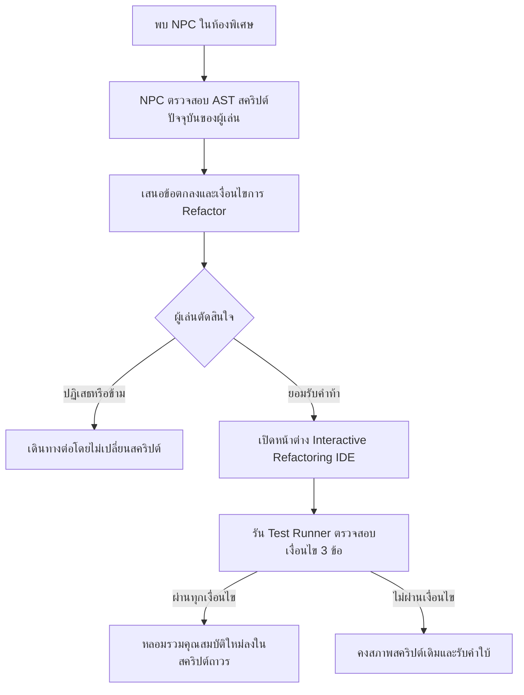
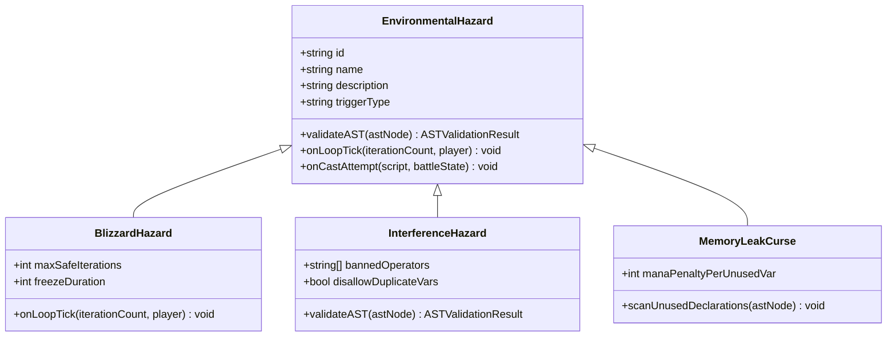
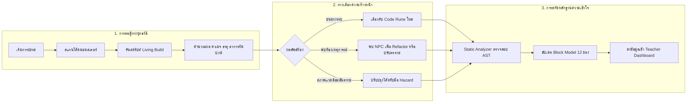

# 03: ROGUELITE PROGRESSION AND CODE RUNES
## สถาปัตยกรรมระบบความก้าวหน้า รูนดัดแปลงตรรกะ เหตุการณ์ และการประเมินผลความเข้าใจ (CODE DEPTHS)

เอกสารฉบับนี้กำหนดรายละเอียดเชิงวิศวกรรมและเกมดีไซน์สำหรับระบบความก้าวหน้า (Progression System), รูนดัดแปลงโค้ด (Code Runes), ปฏิสัมพันธ์กับตัวละครที่ไม่ใช่ผู้เล่น (NPC Interaction), สภาพแวดล้อมอันตราย (Environmental Hazards) และการเชื่อมต่อหลักฐานความเข้าใจเข้าสู่ Block Model ของเกม CODE DEPTHS

---

## 1. ปรัชญา "Code as Living Build" (Living Code Architecture)

### 1.1 จาก Static Snippet สู่ Living Spell Engine
ในเกมการศึกษาดั้งเดิม โค้ดมักถูกปฏิบัติเหมือน "ข้อสอบแบบคงที่" (Static Quiz) ที่นักเรียนมีหน้าที่เพียงอ่านหรือตอบถูก-ผิด แต่ใน CODE DEPTHS สคริปต์ที่ผู้เล่นนำเข้าสู่ดันเจี้ยน (Imported Code) จะถูกสถาปนาเป็น **"เครื่องยนต์เวทมนตร์หลัก" (Primary Spell Engine)** ของตัวละคร:

* **โค้ดตั้งต้นคือแกนกลาง (Core Engine):** ฟังก์ชันที่ผู้เล่นนำเข้า เช่น ฟังก์ชันคำนวณผลรวม (Accumulator) หรือค้นหาข้อมูล (Search) จะเป็นโครงสร้างพื้นฐานที่กำหนดจำนวนฮิต ค่าตั้งต้น และรูปแบบการโจมตี
* **การเติบโตผ่านการดัดแปลง (Evolution through Augmentation):** ตลอดเส้นทางในดันเจี้ยน ผู้เล่นจะไม่ทิ้งโค้ดเดิมเพื่อซื้อสกิลใหม่สำเร็จรูป แต่จะได้รับ "รูนตรรกะ" (Code Runes) ชิ้นส่วนโค้ด (AST Nodes) และคำสั่งเงื่อนไขพิเศษที่นำมาประกอบเข้ากับสคริปต์เดิม
* **ผลลัพธ์เชิงประจักษ์ในสนามรบ (Tangible Execution Effect):** ทุกตัวแปรที่เพิ่มขึ้น ทุกเงื่อนไขที่แทรกเข้าไป และทุกลูปที่ถูกปรับแต่ง จะเปลี่ยนตัวเลขดาเมจ อัตราการใช้มานา หรือสถานะทางกายภาพของสนามรบจริงทันที

### 1.2 วงจรชีวิตของสคริปต์ในดันเจี้ยน (Run Lifecycle of Code)

```text
[Import Code] 
      │
      ▼
[Base Ability Script] (ความสามารถพื้นฐานตามโครงสร้างโค้ดดั้งเดิม)
      │
      ├─► [Combat Room] ─────────► ทดสอบประสิทธิภาพสคริปต์กับมอนสเตอร์
      │                                │
      ├─► [Loot Reward] ─────────► ได้รับ Code Rune (AST Block ใหม่)
      │                                │
      ├─► [NPC Forge / Alchemist]► ปรับปรุงโครงสร้างโค้ด (Refactor / Guard Clauses)
      │                                │
      ├─► [Hazard Chamber] ──────► ปรับแก้ตรรกะเพื่อเอาชีวิตรอดจากข้อจำกัดแวดล้อม
      │                                │
      ▼                                ▼
[Evolved Living Build] ──────► เข้าปะทะบอสประจำด่าน (The Core Boss Dueling)
```

### 1.3 การแยกความบริสุทธิ์ของข้อมูล (Learning Evidence vs Gameplay Modifiers)
เพื่อป้องกันไม่ให้ไอเทมหรือดวงในเกมทำให้ข้อมูลการประเมินทักษะของผู้เรียนบิดเบือน สถาปัตยกรรมจะแยกข้อมูลออกเป็น 2 กระแสชัดเจน:

1. **Gameplay State (คะแนนและความได้เปรียบในเกม):** HP, Focus Mana, Runes, Buffs, Relics มีผลต่อการแพ้ชนะในดันเจี้ยนรอบนั้นๆ
2. **Pedagogical Evidence Stream (หลักฐานความเข้าใจเชิงวิชาการ):** การตอบคำถาม Predict ก่อนรัน, ความสามารถในการเขียน Guard Clause ป้องกันบั๊กจริง, การ Trace ลำดับการทำงาน และการ Refactor โค้ดตามโจทย์ จะถูกบันทึกเป็นหลักฐานดิบ (Raw Evidence) เพื่อนำไปประเมินระดับความเชี่ยวชาญใน Block Model 12 ช่อง โดยไม่นำค่าพลังหรือรูนดาเมจมาคิดเป็นความฉลาดของผู้เรียน

---

## 2. ระบบรูนตรรกะพิเศษ (Code Runes & Logic Modifiers)

Code Rune คือโมดูลตรรกะขนาดเล็ก (Micro Logic Block) ที่ผู้เล่นได้รับเป็นรางวัลจากการต่อสู้หรือหีบสมบัติ รูนแต่ละอันประกอบด้วยโค้ดชิ้นส่วนจริง (AST Fragment) ที่จะถูกเสียบเข้าไปในจุดยึด (Placement Slots) ของสคริปต์หลัก

```
[Primary Script]
┌──────────────────────────────────────────────┐
│ slot: "guard"       <-- Guard Runes          │
│ function castSpell(battleState, target) {    │
│   slot: "accumulator" <-- Stat Modifiers     │
│   for (let i = 0; i < limit; i++) {          │
│     slot: "loop_body" <-- Trigger Runes      │
│   }                                          │
│   slot: "return"     <-- Final Filter Runes  │
│   return spellAction;                        │
│ }                                            │
└──────────────────────────────────────────────┘
```

### 2.1 หมวดหมู่ที่ 1: Risk / Reward Runes (ความเสี่ยงแลกผลตอบแทนสูง)
เน้นการสร้างสถานการณ์ Trade-off ที่ผู้เล่นต้องบริหารจัดการทรัพยากร ไม่ใช่การเพิ่มพลังฟรี

#### รูน R-01: โอเวอร์คล็อกคอร์ (Overclock Core)
* **กลไกเชิงตรรกะ:** สอดแทรกการคำนวณคริติคอล 300% แลกกับการเสียมานาเพิ่มขึ้น 15 หน่วยต่อการร่าย และเพิ่มความร้อนสะสม Overheat 25%
* **AST Placement Slot:** `accumulator` และ `return`
* **Injected Snippet:**
  ```javascript
  // Injected at accumulator:
  let __critRoll = Math.random();
  let __isOverclocked = __critRoll < 0.25;
  if (__isOverclocked) {
    action.manaConsumed += 15;
    action.baseDamage *= 3.0;
    action.isCritical = true;
    action.sideEffects.push("Overclock Core Activated: Mana Drained");
  }
  ```
* **ผลกระทบในสนามรบ:** หากมานาไม่พอ การร่ายจะติด Spell Fizzle (ดาเมจ 0)

#### รูน R-02: ลูปคลั่งสังเวยเลือด (Reckless Overdrive)
* **กลไกเชิงตรรกะ:** บังคับให้ลูปทำงานเพิ่มขึ้น 2 รอบในทุกการร่าย แต่ละรอบที่เพิ่มขึ้นจะลด Program Integrity (HP) ของผู้เล่น 4 หน่วย
* **AST Placement Slot:** `loop_body`
* **Injected Snippet:**
  ```javascript
  // Injected at loop_body:
  if (iterationIndex >= baseLoopLimit) {
    playerState.currentHp = Math.max(1, playerState.currentHp - 4);
    action.baseDamage += 12;
    action.sideEffects.push("Blood Siphon: HP consumed for damage");
  }
  ```

#### รูน R-03: ตัวแปรแปรปรวน (Volatile Memory)
* **กลไกเชิงตรรกะ:** ทำการสุ่มตัวคูณดาเมจระหว่าง 0.5x ถึง 2.5x ตามค่าแฮชของชื่อตัวแปรที่ใช้
* **AST Placement Slot:** `return`
* **Injected Snippet:**
  ```javascript
  const __variance = (Math.sin(battleState.turnNumber * 1.337) + 1) * 1.0 + 0.5;
  action.baseDamage = Math.floor(action.baseDamage * __variance);
  action.sideEffects.push(`Volatile Fluctuation: Multiplier x${__variance.toFixed(2)}`);
  ```

---

### 2.2 หมวดหมู่ที่ 2: Conditional Trigger Runes (เงื่อนไขเปลี่ยนสถานะการรบ)
สอนเรื่องการใช้คำสั่งเงื่อนไข (`if/else`) เพื่อตอบสนองต่อ State ของการต่อสู้อย่างชาญฉลาด

#### รูน C-01: โปรโตคอลเอาชีวิตรอด (Desperation Protocol)
* **กลไกเชิงตรรกะ:** หาก HP ปัจจุบันของผู้เล่นต่ำกว่า 30% ของ Max HP ดาเมจทั้งหมดในเทิร์นนั้นจะถูกแปลงเป็น Life Steal ดูดเลือดกลับคืนมา 50% ของดาเมจที่ทำได้
* **AST Placement Slot:** `return`
* **Injected Snippet:**
  ```javascript
  if (playerState.currentHp / playerState.maxHp < 0.30) {
    const lifestealAmount = Math.floor(action.baseDamage * 0.50);
    playerState.currentHp = Math.min(playerState.maxHp, playerState.currentHp + lifestealAmount);
    action.sideEffects.push(`Desperation Protocol: Restored ${lifestealAmount} HP`);
  }
  ```

#### รูน C-02: เรโซแนนซ์ธาตุสายฟ้า (Elemental Resonance: Shock)
* **กลไกเชิงตรรกะ:** ตรวจสอบสถานะของศัตรูเป้าหมาย หากเป้าหมายมีสถานะ `Burn` อยู่แล้ว ให้เปลี่ยนธาตุของการโจมตีเป็น `Lightning` และเพิ่มสถานะ `Overheat` ให้มอนสเตอร์
* **AST Placement Slot:** `guard`
* **Injected Snippet:**
  ```javascript
  const targetHasBurn = targetEnemy.activeStatusEffects.some(e => e.type === "Burn");
  if (targetHasBurn) {
    action.element = "Lightning";
    action.armorPiercingPercent = 50;
    action.sideEffects.push("Elemental Resonance: Vaporize & Shock triggered");
  }
  ```

#### รูน C-03: ปราการสะท้อนตรรกะ (Reactive Ward)
* **กลไกเชิงตรรกะ:** หากผู้เล่นถูกโจมตีในเทิร์นก่อนหน้า (Last Damage > 0) การประมวลผลจะสร้างโล่สะท้อนความเสียหาย 40% กลับไปยังศัตรูที่โจมตี
* **AST Placement Slot:** `return`
* **Injected Snippet:**
  ```javascript
  if (playerState.lastTurnDamageTaken > 0) {
    action.sideEffects.push(`Reactive Ward: Reflected ${Math.floor(playerState.lastTurnDamageTaken * 0.4)} damage`);
  }
  ```

---

### 2.3 หมวดหมู่ที่ 3: Optimization & Constraints Runes (คุณภาพโค้ดคือพลัง)
ส่งเสริมให้นักเรียนเขียนโค้ดที่กระชับ ไม่ซับซ้อน และปราศจาก Side-effect

#### รูน O-01: มินิมอลลิสต์เซน (Zen Minimalist)
* **กลไกเชิงตรรกะ:** ตรวจสอบความยาวของโค้ดสคริปต์ หากสคริปต์มีความยาวไม่เกิน 5 บรรทัด (ไม่นับบรรทัดว่างและคอมเมนต์) ผู้เล่นจะได้รับ Radiant Barrier ป้องกันดาเมจ 20 หน่วยทุกเทิร์นโดยไม่เสียมานา
* **AST Placement Slot:** `guard`
* **Constraint Check:** `metrics.nonEmptyLines <= 5`
* **รางวัลสถานะ:** `baseArmor += 20` แบบ Passive

#### รูน O-02: ฟังก์ชันบริสุทธิ์ (Pure Function Aegis)
* **กลไกเชิงตรรกะ:** ตรวจสอบว่าโค้ดไม่มีการแก้ไข Global Variable ภายนอก Scope หรือเรียกฟังก์ชันสุ่มที่ไม่ระบุ Seed ผู้เล่นจะได้รับอัตราฟื้นฟู Focus Mana เพิ่มขึ้น +20 หน่วยต่อเทิร์น
* **AST Placement Slot:** `guard`
* **Constraint Check:** `metrics.hasExternalMutation === false`
* **รางวัลสถานะ:** `manaRegenBonus = 20`

#### รูน O-03: สัตยาบันเชิงเส้น (Linear Complexity Vow)
* **กลไกเชิงตรรกะ:** หากสคริปต์ไม่มี Nested Loop (ระดับความลึกของลูปไม่เกิน 1) การโจมตีทั้งหมดจะได้รับคุณสมบัติเจาะเกราะ (Armor Piercing) 40% ถาวร
* **AST Placement Slot:** `loop_body`
* **Constraint Check:** `metrics.maxLoopDepth <= 1`
* **รางวัลสถานะ:** `action.armorPiercingPercent = Math.max(action.armorPiercingPercent, 40)`

---

### 2.4 สเปกโครงสร้างข้อมูล Code Rune (TypeScript Data Contract)

```typescript
import { ElementType, StatusEffectType, PlayerCombatState, BattleSnapshot } from "./04_DATA_MODELS_AND_INTERFACE_CONTRACTS";

export type RuneCategory = "RiskReward" | "ConditionalTrigger" | "OptimizationConstraint" | "ElementalInfusion";
export type PlacementSlot = "guard" | "loop_body" | "accumulator" | "return";
export type RuneRarity = "Common" | "Uncommon" | "Rare" | "Legendary" | "Cursed";

export interface RuneConstraintRequirements {
  maxLinesOfCode?: number;
  maxCyclomaticComplexity?: number;
  maxLoopDepth?: number;
  bannedKeywords?: string[];
  requiredKeywords?: string[];
  targetElementCompatibility?: ElementType[];
}

export interface RuneStatModifiers {
  baseDamageDelta?: number;
  manaCostDelta?: number;
  critChanceDelta?: number;
  critMultiplierDelta?: number;
  armorPiercingDelta?: number;
  grantedStatusEffect?: StatusEffectType;
}

export interface CodeRune {
  id: string;
  name: string;
  category: RuneCategory;
  rarity: RuneRarity;
  description: string;
  placementSlot: PlacementSlot;
  injectedSnippet: string;
  statModifiers: RuneStatModifiers;
  requirements: RuneConstraintRequirements;
  riskDescription: string;
  rewardDescription: string;
  pedagogicalObjective: {
    blockCellId: string; // e.g. "structure_execution", "function_purpose"
    conceptTaught: string; // e.g. "guard_clauses", "early_exit", "loop_invariants"
  };
}
```

---

## 3. ระบบ NPC และคำขอปรับแต่งโค้ด (Interactive NPCs & Refactoring Quests)

NPC ใน CODE DEPTHS ไม่ใช่พ่อค้าขายของทั่วไป แต่เป็น "ผู้ตรวจทานโค้ด (Code Reviewers & Guild Masters)" ที่เสนอข้อตกลงเพื่อยกระดับสคริปต์ของผู้เล่น



### 3.1 NPC ช่างตีเหล็กรีแฟกเตอร์: เคล ค้อนเพลิง (Refactor Forge - Ironweaver Kael)
* **บุคลิกและบทบาท:** ช่างตีเหล็กผู้เชี่ยวชาญโครงสร้างตรรกะ มองโค้ดเหมือนเนื้อเหล็กที่ต้องตีให้เข้ารูป
* **เควสต์ที่มอบหมาย (Refactoring Challenge):**
  * **โจทย์:** "สคริปต์ปัจจุบันของเจ้ารองรับศัตรูเพียงตัวเดียว ข้าต้องการให้เจ้าปรับลูปให้สามารถประมวลผลศัตรูทั้งสนาม (`allEnemies`) โดยกระจายดาเมจแบบเท่าเทียม แต่ห้ามเพิ่มจำนวนบรรทัดเกิน 4 บรรทัด!"
  * **โค้ดก่อนปรับแต่ง (Original Code):**
    ```javascript
    function castSpell(battleState, target) {
      let damage = 40;
      target.currentHp -= damage;
      return { actionType: "Attack", baseDamage: damage };
    }
    ```
  * **โค้ดที่ผ่านเงื่อนไข (Refactored Solution):**
    ```javascript
    function castSpell(battleState, target) {
      const splitDamage = Math.floor(40 / battleState.allEnemies.length);
      battleState.allEnemies.forEach(enemy => enemy.currentHp -= splitDamage);
      return { actionType: "Attack", baseDamage: 40, targetMode: "AllEnemies" };
    }
    ```
* **รางวัลตอบแทน (Reward):**
  * **Elemental Infusion:** อาวุธได้รับธาตุไฟ (Fire Element) ถาวร พร้อมเพิ่มดาเมจแบบกระจาย 25% เมื่อศัตรูมีมากกว่า 1 ตัว
  * **Block Model Update:** บันทึกหลักฐานทักษะในเซลล์ `Structure - Program Execution` และ `Function - System/Domain`

---

### 3.2 NPC นักเล่นแร่แปรธาตุ: เวสเปรา สังเคราะห์สูญ (The Null Alchemist - Vespera)
* **บุคลิกและบทบาท:** นักวิทยาศาสตร์หญิงผู้คลั่งไคล้ความสมบูรณ์แบบและการกำจัดข้อผิดพลาด Null Pointer
* **เควสต์ที่มอบหมาย (Defensive Guard Clause Challenge):**
  * **โจทย์:** "ยาพิษในดันเจี้ยนแห่งนี้มักส่งค่าเป้าหมายว่างเปล่า (`null` หรือ `undefined`) เข้าสู่ฟังก์ชัน จงสอดแทรก Guard Clause ตรวจสอบความถูกต้องของอาร์กิวเมนต์ที่จุดเริ่มต้น หากเป้าหมายไม่สมบูรณ์ให้คืนค่าการป้องกันตนเองทันทีแทนที่จะเกิด Runtime Exception!"
  * **โค้ดก่อนปรับแต่ง (Vulnerable Code):**
    ```javascript
    function executeStrike(target) {
      let power = target.stats.defense * 1.5;
      return { baseDamage: power };
    }
    ```
  * **โค้ดที่ผ่านเงื่อนไข (Guarded Solution):**
    ```javascript
    function executeStrike(target) {
      if (!target || !target.stats) {
        return { actionType: "Shield", baseDamage: 25, sideEffects: ["Null evaded: Defensive stance activated"] };
      }
      return { actionType: "Attack", baseDamage: target.stats.defense * 1.5 };
    }
    ```
* **รางวัลตอบแทน (Reward):**
  * **Elixir of Purity:** ได้รับไอเทมยาฟื้นฟู Max HP +30 และสคริปต์ได้รับความสามารถ Passive: เมื่อใดก็ตามที่ Guard Clause ทำงานสำเร็จในระหว่างต่อสู้ ผู้เล่นจะฟื้นฟูมานา 10 หน่วย
  * **Block Model Update:** บันทึกหลักฐานทักษะในเซลล์ `Structure - Text Surface` (Syntax of conditional returns) และ `Function - Purpose` (Robustness)

---

### 3.3 NPC นักพนันเวทมนตร์: แจ็ค ไบต์ (The Quantum Gambler - Jack Byte)
* **บุคลิกและบทบาท:** จอมเวทนอกรีตผู้เชื่อว่าการประมวลผลคือเกมแห่งความน่าจะเป็น
* **เควสต์การเดิมพัน (Execution Betting Encounter):**
  * **โจทย์:** ผู้เล่นต้องวางเดิมพันก่อนเริ่มการร่ายในเทิร์นถัดไป โดยเลือกระหว่าง:
    1. **Parity Bet:** ทายว่าผลรวมดาเมจสุทธิจากการรันรอบถัดไปจะเป็น "เลขคู่" (Even) หรือ "เลขคี่" (Odd)
    2. **Loop Iteration Exact Match:** ทายว่าลูปในสคริปต์จะหยุดทำงานที่รอบเท่าใดอย่างแม่นยำ
  * **เงื่อนไข:** ผู้เล่นสามารถปรับเปลี่ยนค่าคงที่เริ่มต้น (Seed/Initial Value) ในโค้ดก่อนกดรัน เพื่อบังคับให้ผลลัพธ์เป็นไปตามที่ตนเดิมพันไว้
* **ผลลัพธ์การแพ้-ชนะ:**
  * **ชนะเดิมพัน:** ได้รับ Legendary Code Rune: `Quantum Shift` (โอกาส 50% ดาเมจเพิ่มเป็น 4 เท่า)
  * **แพ้เดิมพัน:** สคริปต์จะถูกลงทัณฑ์ด้วย Curse of Verbose Logging: ทุกเทิร์นจะมีการพิมพ์ `console.log` ป่วนหน้าจอ และหัก Focus Mana เทิร์นละ 5 หน่วยตลอดดันเจี้ยน
  * **Block Model Update:** บันทึกหลักฐานในเซลล์ `Program Execution - State Tracking`

---

## 4. คำสาปและเงื่อนไขสภาพแวดล้อม (Environmental Hazards & Curses)

ดันเจี้ยนใน CODE DEPTHS มีสนามพลังและสภาวะผิดปกติที่จะบังคับใช้กฎพิเศษกับ JavaScript Virtual Machine ของผู้เล่น สภาพแวดล้อมเหล่านี้ทำหน้าที่เป็นตัวผลักดันให้ผู้เล่นต้องปรับเปลี่ยนโครงสร้างโค้ด (Adapt Code Structure) เพื่อเอาชีวิตรอด



### 4.1 ห้องพายุหิมะเยือกแข็ง (Glacial Blizzard Room)
* **กฎสภาพแวดล้อม (Cold Step Constraint):** อุณหภูมิที่ติดลบทำให้การประมวลผลที่ยาวนานสูญเสียความร้อน หากลูปของผู้เล่นหมุนวนเกิน 5 รอบ (`iterationsCount > 5`) ระบบความร้อนจะหยุดชะงักและผู้เล่นจะติดสถานะ **Freeze** ข้ามเทิร์นถัดไปทันที
* **การทำงานของ Engine:**
  ```javascript
  function checkBlizzardRule(iterationIndex, playerState) {
    if (iterationIndex > 5) {
      playerState.activeStatusEffects.push({
        type: "Freeze",
        durationTurns: 1,
        potency: 1,
        source: "environment"
      });
      return { abortExecution: true, reason: "Blizzard Freeze Triggered: Excessive Loops" };
    }
    return { abortExecution: false };
  }
  ```
* **แนวทางการแก้ทางของผู้เล่น (Tactical Solutions):**
  * ผู้เล่นต้องใส่คำสั่ง `break;` เมื่อสะสมดาเมจถึงระดับที่ต้องการ
  * ปรับ Step Increment ของลูปให้ก้าวกระโดดขึ้น เช่น `i += 2` แทนที่จะเป็น `i++`
  * เปลี่ยนจากการใช้ลูปมาเป็นการใช้การคำนวณทางคณิตศาสตร์แบบตรง (Direct Formula)

---

### 4.2 ห้องสนามพลังรบกวนคลื่นควอนตัม (Quantum Interference Field)
* **กฎสภาพแวดล้อม (Variable Entropy & Operator Prohibition):**
  1. **ห้ามใช้ตัวดำเนินการบวก (`+` Operator Banned):** สัญญาณคลื่นแม่เหล็กไฟฟ้ารบกวนการบวกเลข หากพบเครื่องหมาย `+` ใน AST ตัวสคริปต์จะเกิด Overflow Damage สะท้อนกลับใส่ผู้เล่น 30 หน่วย
  2. **ห้ามใช้ชื่อตัวแปรซ้ำ (Unique Identifier Constraint):** สโคปทั้งหมดห้ามมีการ Re-declare หรือ Shadowing ชื่อตัวแปรเดียวกัน
* **แนวทางการแก้ทางของผู้เล่น (Tactical Solutions):**
  * หลีกเลี่ยงการใช้ `+` โดยใช้การลบด้วยค่าติดลบ เช่น `x - (-y)`
  * ใช้การเลื่อนบิต (Bitwise Shift) หรือคำสั่งคูณ `x * 1`
  * ใช้ฟังก์ชันสำเร็จรูป เช่น `Math.max()` หรือ `.concat()` สำหรับอาเรย์

---

### 4.3 ห้องแรงโน้มถ่วงผกผัน (Gravity Inversion Chamber)
* **กฎสภาพแวดล้อม (Execution Order Reversed):** การอ่านข้อมูลจากอาเรย์ต้องทำจากดัชนีสุดท้ายย้อนกลับมาดัชนีแรกสุด (Reverse Traversal) หากผู้เล่นอ่านข้อมูลจากดัชนี `0` ขึ้นไป เกราะของศัตรูจะเพิ่มขึ้น 200% ตามกฎของแรงเฉื่อยย้อนกลับ
* **แนวทางการแก้ทางของผู้เล่น (Tactical Solutions):**
  * ปรับโครงสร้างลูป: `for (let i = list.length - 1; i >= 0; i--)`
  * ใช้คำสั่ง `.slice().reverse().forEach(...)`

---

### 4.4 คำสาปหน่วยความจำรั่วไหล (Curse of Dangling Pointers)
* **เงื่อนไขคำสาป (Curse Mechanics):** ได้รับจากการเปิดหีบต้องสาปหรือแพ้การเดิมพัน
* **ผลกระทบ:** ตัววิเคราะห์โค้ด (Static AST Analyzer) จะตรวจสอบตัวแปรทั้งหมดที่ถูกประกาศ (`let`, `const`, `var`) หากตัวแปรใดถูกประกาศไว้แต่ไม่เคยถูกเรียกใช้งานจริง (Unused Variables) จะสูญเสีย Max Mana ถาวร 5 หน่วยต่อหนึ่งตัวแปรในทุกๆ ห้องต่อสู้
* **วิธีล้างคำสาป:** ต้องเข้าพบ NPC ช่างตีเหล็ก หรือคลีนโค้ดในห้องพักผ่อน (Rest Site) ให้เป็น Clean Code ที่ไร้ตัวแปรขยะ

---

## 5. วงจรความก้าวหน้าและการเชื่อมต่อ Block Model (Progression Loop & Learning Mastery Bridge)

สถาปัตยกรรมความก้าวหน้าใน CODE DEPTHS ถูกออกแบบเพื่อสร้างสะพานเชื่อมระหว่าง "การเล่นเกมที่สนุกเร้าใจ" เข้ากับ "แบบจำลองความเข้าใจของผู้เรียน" (The 12-Cell Block Model) ตามมาตรฐานวิทยาการคอมพิวเตอร์ศึกษา

### 5.1 ผังวงจรการเล่นระดับรอบ (The Dungeon Micro-Loop)



### 5.2 เมทริกซ์การเชื่อมต่อกับ Block Model 12 ช่อง (The 12-Cell Mapping Matrix)

Block Model แบ่งการประเมินออกเป็น 3 มิติเชิงโครงสร้าง (Surface, Structure, Function) ตัดกับ 4 มิติเชิงขอบเขต (Text Surface, Execution, Purpose, System):

| รหัสเซลล์ | มิติของ Block Model | เหตุการณ์ในเกมที่สร้างหลักฐาน (Game Action) | ตัวอย่างการประเมินจริง |
|---|---|---|---|
| **C1** | Text Surface x Atom | การติดตั้ง Code Rune ใน Placement Slot ที่ถูกต้อง | ตรวจสอบว่าผู้เล่นเข้าใจ語法 (Syntax) ของตัวแปรและประเภทข้อมูลที่รูนต้องการ |
| **C2** | Text Surface x Block | การสอดแทรก Guard Clause ของ NPC Vespera | ตรวจสอบว่าผู้เล่นเขียนบล็อกคำสั่ง `if (...) { return ... }` ได้อย่างถูกต้องตามหลักไวยากรณ์ |
| **C3** | Text Surface x Relation | การเชื่อมตัวแปรระหว่าง Injected Snippet กับ Core Script | ตรวจสอบว่าเข้าใจ Scope ของตัวแปรว่ามองเห็นข้ามบล็อกได้หรือไม่ |
| **C4** | Text Surface x Macro | การคงสภาพโครงสร้างฟังก์ชันหลักทั้งหมดขณะ Refactor | ตรวจสอบว่าฟังก์ชันยังคงมี Signature และ Return Type ตามสัญญา Interface |
| **C5** | Program Execution x Atom | การทำนายค่าตัวแปรในรูน Volatile Memory | ตรวจสอบความแม่นยำในการคำนวณ State ของตัวแปรเดี่ยวในแต่ละสเต็ป |
| **C6** | Program Execution x Block | การปรับลูปแก้พายุหิมะ (Blizzard Iteration Constraint) | ตรวจสอบว่าเข้าใจการทำงานของลูปและจำนวนรอบจริงในการรัน |
| **C7** | Program Execution x Relation | การทำคอมโบธาตุ (Elemental Synergy) เช่น Water สู่ Ice | ตรวจสอบความเข้าใจเรื่องลำดับการประมวลผล (Control Flow & Sequence) |
| **C8** | Program Execution x Macro | การวิเคราะห์การเกิด Overheat (Infinite Loop Prevention) | ตรวจสอบความเข้าใจพฤติกรรมภาพรวมของการประมวลผลที่ไม่สิ้นสุด |
| **C9** | Function/Purpose x Atom | การเลือกใช้ตัวดำเนินการทางเลือกในห้อง Quantum Field | ตรวจสอบว่าเข้าใจบทบาทหน้าที่ของ Operator แต่ละตัวอย่างแท้จริง |
| **C10** | Function/Purpose x Block | การเขียน Guard Clause เพื่อป้องกัน Null Pointer | ตรวจสอบว่าเข้าใจวัตถุประสงค์ของการป้องกันข้อผิดพลาดที่ต้นทาง |
| **C11** | Function/Purpose x Relation | การปรับสคริปต์เดี่ยวให้เป็น Multi-target ให้ NPC Kael | ตรวจสอบว่าเข้าใจเป้าหมายการแปลงอัลกอริทึมจาก 1 สู่ N ตัว |
| **C12** | Function/Purpose x Macro | การเอาชนะ The Core Boss ด้วย Living Build ที่สมบูรณ์ | ยืนยันความสามารถในการบูรณาการระบบทั้งหมดเพื่อแก้โจทย์ขนาดใหญ่ |

---

### 5.3 มาตรวัดความก้าวหน้าถาวร (Meta-Progression & Persistence)

เมื่อผู้เล่นจบการเดินทางในดันเจี้ยน (ไม่ว่าจะชนะหรือพ่ายแพ้) ระบบจะประมวลผลข้อมูลเพื่อส่งต่อสู่ความก้าวหน้าถาวร:

1. **Codex of Solved Runes (คลังรูนที่เข้าใจอย่างถ่องแท้):**
   * รูนใดก็ตามที่ผู้เล่นติดตั้งแล้วนำไปผ่านการรบจริงโดยไม่มีข้อผิดพลาดเกิน 3 ครั้ง จะถูกปลดล็อกใน Codex
   * ใน Codex จะมีคำอธิบายเชิงลึกถึง Best Practice ทางวิศวกรรมซอฟต์แวร์ เช่น "ทำไม Guard Clause จึงดีกว่า Nested If ลึกๆ"
2. **Knowledge Mastery Blueprint:**
   * สรุปจุดแข็ง-จุดอ่อนส่งตรงไปยังหน้าจอของครูผู้สอน (Teacher Dashboard)
   * หากระบบพบว่าผู้เรียนมักล้มเหลวในห้องพายุหิมะ (Loop Constraints) ซอฟต์แวร์จะแนะนำให้ครูมอบหมายใบงานเสริมเรื่อง Loop Boundaries และ Break/Continue
3. **Ascension Depth Level (ระดับความลึกของดันเจี้ยน):**
   * เมื่อผู้เรียนมีค่าเฉลี่ย Mastery ใน Block Model เกิน 80% ระบบจะปลดล็อกดันเจี้ยนชั้นที่ลึกขึ้น ซึ่งมีเงื่อนไขสภาพแวดล้อมซับซ้อน เช่น การตรวจสอบ Memory Complexity หรือ Asynchronous Execution

---

## 6. สรุปความพร้อมของสถาปัตยกรรม (Architectural Invariants & Verification)

1. **ไม่ทำลายระบบเดิม:** ระบบทั้งหมดทำงานครอบบนสถาปัตยกรรม WebWorker Sandbox และ Supabase Database Schema ที่มีอยู่เดิม
2. **ไม่ใช้การเดาสุ่ม:** รูนทุกอันมีสเปกชัดเจนทั้งด้าน AST Placement, Mana Consumption และผลกระทบต่อสูตรคำนวณดาเมจ
3. **เคารพกฎความปลอดภัย:** การรันโค้ดทั้งหมดเกิดขึ้นใน Isolated Sandbox พร้อมระบบตรวจจับ Infinite Loop Watchdog (จำกัดเวลาทำงานไม่เกิน 500ms ต่อการร่าย)
4. **งดเว้นการใช้อิโมจิ:** ยึดมั่นตามข้อกำหนดระบบอย่างเคร่งครัดในทุกส่วนของเอกสารและโค้ดตัวอย่าง
5. **เตรียมพร้อมส่งต่อ:** ข้อมูลทั้งหมดในเอกสารนี้สอดคล้องกับ `04_DATA_MODELS_AND_INTERFACE_CONTRACTS.md` 100% และพร้อมนำไปพัฒนาเป็นคอมโพเนนต์ React และ API Routes ต่อไปทันที