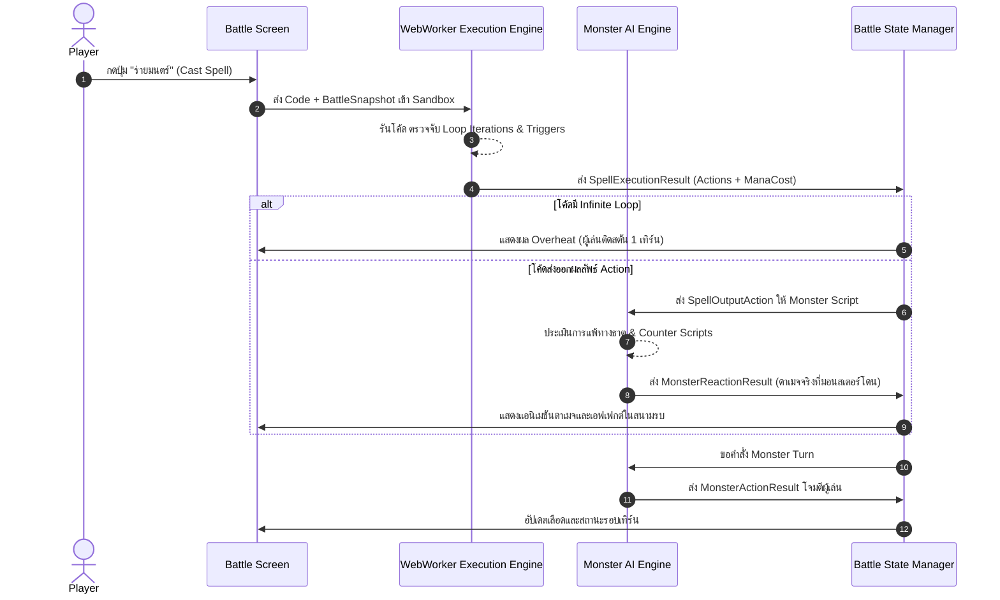

# 04: DATA MODELS AND INTERFACE CONTRACTS
## สัญญาข้อมูลกลางและสถาปัตยกรรมประเภทข้อมูล (Tactical Code-Battler)

เอกสารฉบับนี้ทำหน้าที่เป็น **Single Source of Truth (SSOT)** สำหรับสัญญาข้อมูล (Data Contracts) และประเภทข้อมูล (Type Definitions) ของเกม CODE DEPTHS เพื่อให้ระบบ Combat Engine, Monster AI และ Progression Service เชื่อมต่อและทำงานร่วมกันได้อย่างสมบูรณ์

---

## 1. หน่วยข้อมูลพื้นฐาน (Primitive Types & Enums)

```typescript
export type ElementType = "Physical" | "Fire" | "Water" | "Ice" | "Lightning" | "Wind" | "Earth";

export type StatusEffectType = 
  | "Burn"       // ดาเมจไฟต่อเนื่อง
  | "Freeze"     // ข้ามเทิร์น
  | "Shock"      // เสียมานาเพิ่มขึ้นเมื่อร่าย
  | "SteamCover" // หลบการโจมตี
  | "Overheat"   // ชาร์จพลังค้างจากการวนลูปไม่รู้จบ (ติดสตัน 1 เทิร์น)
  | "Empowered"; // ดาเมจเพิ่มขึ้น

export interface StatusEffect {
  type: StatusEffectType;
  durationTurns: number;
  potency: number;
  source: "player" | "monster" | "environment";
}

export type ActionIntentType = "Attack" | "Shield" | "Debuff" | "Counter" | "Heal";
```

---

## 2. โครงสร้างสถานะตัวละครและศัตรู (Entities)

```typescript
export interface CombatEntity {
  id: string;
  name: string;
  currentHp: number;
  maxHp: number;
  currentMana: number;
  maxMana: number;
  baseArmor: number;
  activeStatusEffects: StatusEffect[];
}

export interface PlayerCombatState extends CombatEntity {
  programIntegrity: number; // 0 - 100
  focusMana: number;        // 0 - 100
  activeRunes: CodeRune[];
  overheatCooldown: number; // หาก > 0 จะไม่สามารถร่ายได้
}

export interface MonsterScriptDefinition {
  inspectableCode: string;  // โค้ดที่ผู้เล่นสามารถส่องดูได้
  onIncomingSpell: (incoming: SpellOutputAction, battleState: BattleSnapshot) => MonsterReactionResult;
  onTurnAction: (battleState: BattleSnapshot) => MonsterActionResult;
}

export interface MonsterEntity extends CombatEntity {
  tier: "minion" | "elite" | "boss";
  currentPhase: number;
  elementalAffinity: Record<ElementType, number>; // ตัวคูณดาเมจ (เช่น Fire: 1.5, Ice: 0.5)
  script: MonsterScriptDefinition;
}
```

---

## 3. สัญญาการรันโค้ดเวทมนตร์ (Spell Execution Contract)

ฟังก์ชันเวทมนตร์ที่ผู้เล่นเขียน/ดัดแปลง จะมี Interface มาตรฐานดังนี้:

```typescript
export interface BattleSnapshot {
  turnNumber: number;
  player: Readonly<PlayerCombatState>;
  targetEnemy: Readonly<MonsterEntity>;
  allEnemies: Readonly<MonsterEntity[]>;
  environmentalModifiers: EnvironmentalHazard[];
}

export interface SpellOutputAction {
  actionType: "Attack" | "Shield" | "Heal" | "Special";
  baseDamage: number;
  element: ElementType;
  hitCount: number;                 // จำนวนฮิต (คำนวณจากลูป)
  isCritical: boolean;              // ติดคริติคอลหรือไม่ (คำนวณจากเงื่อนไข)
  armorPiercingPercent: number;     // อัตราเจาะเกราะ (0 - 100)
  targetMode: "Single" | "AllEnemies";
  appliedStatus?: StatusEffectType;
  manaConsumed: number;             // มานาที่ต้องใช้ตามตรรกะที่รันจริง
  sideEffects?: string[];           // ข้อความอธิบายเอฟเฟกต์พิเศษ
}

export interface SpellExecutionResult {
  success: boolean;
  action: SpellOutputAction | null;
  errorType?: "InfiniteLoop" | "SyntaxError" | "RuntimeNaN" | "OutOfMana";
  errorMessage?: string;
  executionTimeMs: number;
  iterationsCount: number;
  ramTraceLog: Record<string, unknown>[];
}
```

---

## 4. ผลการตอบสนองของมอนสเตอร์ (Monster Reaction & Action)

```typescript
export interface MonsterReactionResult {
  damageTaken: number;
  absorbedOrReflected: boolean;
  reactionDescription: string;
  stateChangedTo?: string;
  counterAttackAction?: {
    damage: number;
    element: ElementType;
    statusEffect?: StatusEffectType;
  };
}

export interface MonsterActionResult {
  intentType: ActionIntentType;
  targetId: string;
  damage: number;
  element: ElementType;
  description: string;
  statusApplied?: StatusEffectType;
}
```

---

## 5. รูนดัดแปลงโค้ดและสภาพแวดล้อม (Runes & Environment)

```typescript
export interface CodeRune {
  id: string;
  name: string;
  description: string;
  codeSnippet: string;             // บล็อกโค้ดที่จะถูกนำไปประกอบในสคริปต์
  placementSlot: "guard" | "loop_body" | "accumulator" | "return";
  manaCostDelta: number;
  riskDescription: string;
  rewardDescription: string;
}

export interface EnvironmentalHazard {
  id: string;
  name: string;
  ruleDescription: string;
  onLoopIteration?: (iterationIndex: number, player: PlayerCombatState) => void;
  onTurnEnd?: (battleState: BattleSnapshot) => void;
}
```

---

## 6. วงจรการเชื่อมต่อระหว่าง 3 ระบบ (Integrated Architectural Pipeline)


